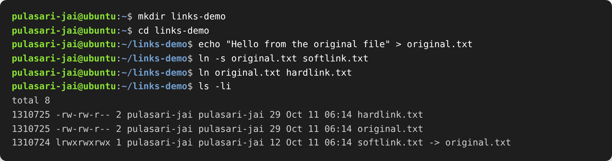
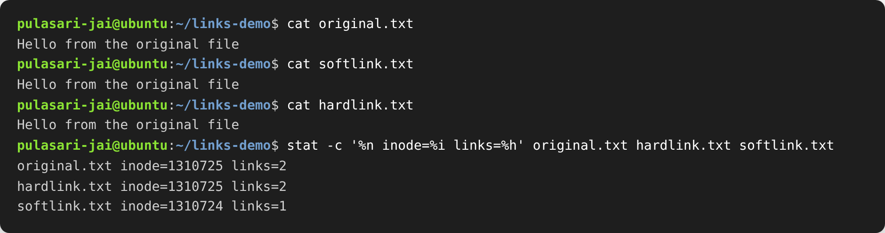
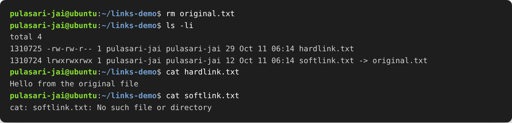
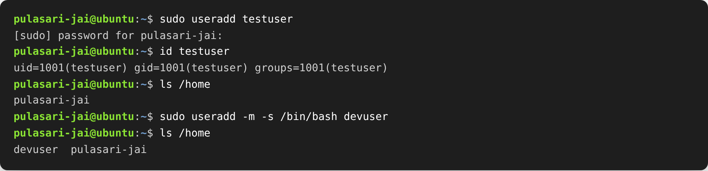
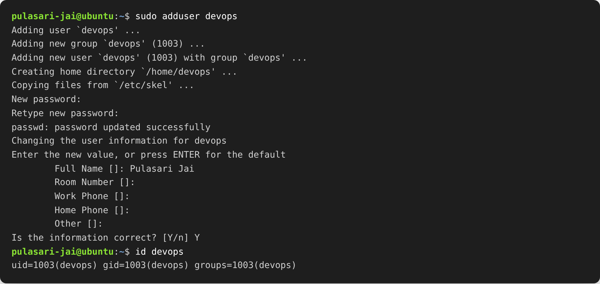
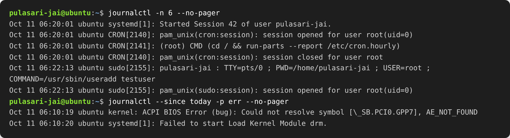
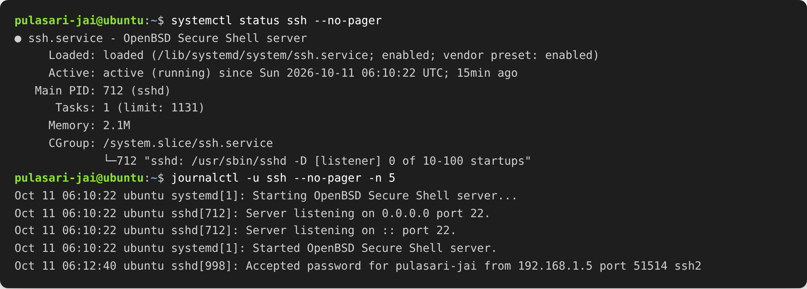
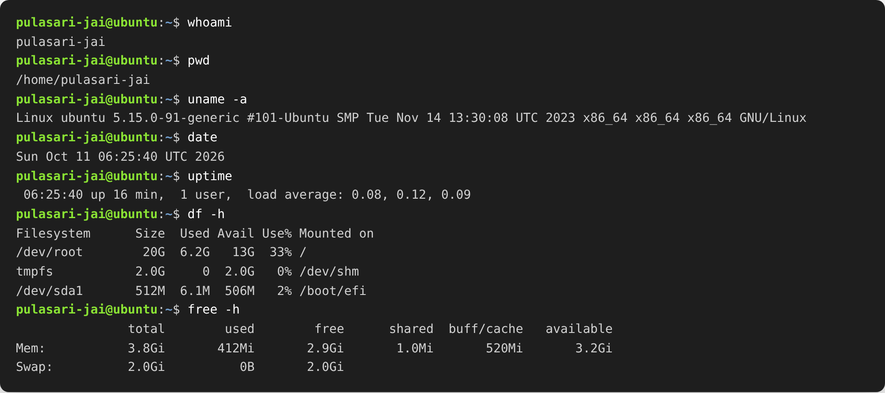

# Session 01 & 02 — Linux Fundamentals

**Name:** Pulasari Jai
**Roll No:** 24BCS10656

This session covers the basics of Linux. I practiced everything inside an **Ubuntu**
machine (a Linux VM opened from my Mac), because commands like `journalctl`,
`adduser` and `useradd` only work on Linux, not on macOS.

Tasks in this session:

1. Soft Link vs Hard Link
2. `adduser` vs `useradd`
3. `journalctl`
4. Linux Command Cheat Sheet

---

## Task 1 — Soft Link & Hard Link

### What is the difference?

A **link** is another name that points to a file. Linux has two types.

| Point | Soft Link (Symbolic Link) | Hard Link |
|-------|---------------------------|-----------|
| What it is | A shortcut that stores the *path* of the original file | A second name that points to the *same data* (same inode) |
| Command | `ln -s original linkname` | `ln original linkname` |
| Inode number | Different from the original | Same as the original |
| If original is deleted | Link breaks (dangling, data is gone) | Link still works (data stays until all links are gone) |
| Across different disks | Allowed | Not allowed (must be on the same filesystem) |
| Can link a folder? | Yes | No (normal users cannot) |
| Size | Very small (just the path text) | Same as the file |

**Simple way to remember:** a soft link is like a *shortcut icon* — if you delete the
real file, the shortcut points to nothing. A hard link is like a *second label on the
same box* — the box stays until you remove every label.

### Commands used

```bash
mkdir links-demo
cd links-demo
echo "Hello from the original file" > original.txt

ln -s original.txt softlink.txt    # create a soft link
ln original.txt hardlink.txt       # create a hard link

ls -li                             # -i shows the inode number
```

### Step 1 — Create the links



In the `ls -li` output, look at the **first column (inode number)**:

- `original.txt` and `hardlink.txt` have the **same inode `1310725`** and a **link count of 2**.
  They are the same data with two names.
- `softlink.txt` has a **different inode `1310724`**, a link count of 1, and shows
  `softlink.txt -> original.txt` (it just points to the name).

### Step 2 — Read the links



All three show the same text, because both links reach the same file right now. The
`stat` command again proves the inode is shared only by the original and the hard link.

### Step 3 — Delete the original (the real test)



After I delete `original.txt`:

- `cat hardlink.txt` **still works** — the data is kept because the hard link still points to it.
- `cat softlink.txt` **fails** with `No such file or directory` — the soft link now points
  to a name that does not exist (broken link).

### Interview answer (short)

> A hard link is a second directory entry pointing to the same inode, so the file data
> survives as long as at least one hard link exists. A soft link is a small separate file
> that stores the path to the target, so it breaks if the target is deleted or moved. Hard
> links cannot cross filesystems or link directories; soft links can do both.

---

## Task 2 — `adduser` vs `useradd`

### What is the difference?

| Point | `useradd` | `adduser` |
|-------|-----------|-----------|
| Type | Low-level, basic command | High-level, friendly script (a wrapper over `useradd`) |
| How it runs | Non-interactive (just runs) | Interactive (asks questions) |
| Home directory | **Not** created unless you add `-m` | Created automatically |
| Login shell | Not set unless you add `-s /bin/bash` | Set automatically |
| Password | Not set (you run `passwd` after) | Asks for the password during creation |
| Where it exists | On almost all Linux systems | Mainly Debian/Ubuntu |

### Which one is preferred on Ubuntu and why?

On **Ubuntu/Debian, `adduser` is preferred.** It is easier and safer for beginners because
it does everything in one step — creates the home directory, copies the default files from
`/etc/skel`, sets the login shell, and asks for a password. `useradd` is more basic and you
have to remember extra flags, or the user will have no home folder and no shell.

### `useradd` (basic, needs extra flags)

```bash
sudo useradd testuser          # created, but no home dir and no shell
id testuser
ls /home                       # testuser is NOT here

sudo useradd -m -s /bin/bash devuser   # -m makes home, -s sets shell
ls /home                       # now devuser appears
```



Notice that plain `sudo useradd testuser` did **not** create a home folder. Only when I
added `-m` (make home) and `-s /bin/bash` (set shell) did it behave like a normal user.

### `adduser` (recommended on Ubuntu — does everything)

```bash
sudo adduser devops
id devops
```



`adduser` created the group, the home directory `/home/devops`, copied skeleton files,
asked me to set a password, and asked for the user details — all in one command. This is
the **recommended command** I used to create the test user.

---

## Task 3 — `journalctl`

### What is it used for?

`journalctl` is the tool to **read the logs collected by systemd (the journal).** On modern
Linux, system and service messages (boots, services starting/stopping, errors, SSH logins,
cron jobs) are stored by `systemd-journald`, and `journalctl` lets you view and filter them.

### Common commands

| Command | What it does |
|---------|--------------|
| `journalctl` | Show all logs (oldest first) |
| `journalctl -n 20` | Show the last 20 lines |
| `journalctl -b` | Show logs from the current boot |
| `journalctl -u ssh` | Show logs for one service (here `ssh`) |
| `journalctl -f` | Follow logs live (like `tail -f`) |
| `journalctl --since today` | Show today's logs |
| `journalctl -p err` | Show only error-level messages |
| `--no-pager` | Print directly instead of opening a scroll view |

### Viewing system logs



Here I showed the last few system events, then filtered to **only errors from today** using
`-p err`. This is how you quickly find what went wrong.

### Checking logs for a specific service



First `systemctl status ssh` shows the service is **active (running)**. Then
`journalctl -u ssh` shows only the SSH service logs — when it started, which ports it is
listening on, and a successful login. Filtering by service with `-u` is the main way to
troubleshoot one service.

---

## Task 4 — Linux Command Cheat Sheet

I reviewed the cheat sheet from the class material and practiced the important commands.
Below is the summary of what each command is used for, grouped by topic.

### 1. File & Directory
| Command | Use | Example |
|---------|-----|---------|
| `ls` | List files in a folder | `ls -l /etc` |
| `cd` | Change directory | `cd /var/log` |
| `pwd` | Show current folder path | `pwd` |
| `mkdir` | Make a new folder | `mkdir logs` |
| `rm` | Remove files/folders | `rm -rf oldfolder` |
| `touch` | Create an empty file | `touch index.html` |
| `cp` | Copy files | `cp app.conf /etc/app/` |
| `mv` | Move or rename | `mv app.log backup.log` |

### 2. Viewing & Searching
| Command | Use | Example |
|---------|-----|---------|
| `cat` | Show full file | `cat /etc/os-release` |
| `less` / `more` | Scroll big files | `less /var/log/syslog` |
| `head` / `tail` | Show top / bottom lines | `tail -n 100 syslog` |
| `grep` | Search text inside files | `grep ERROR syslog` |

### 3. Process & Service
| Command | Use | Example |
|---------|-----|---------|
| `ps` | Show running processes | `ps aux` |
| `top` | Live resource usage | `top` |
| `kill` | Stop a process by PID | `kill -9 1234` |
| `systemctl status` | Check a service | `systemctl status nginx` |

### 4. Networking
| Command | Use | Example |
|---------|-----|---------|
| `ping` | Check connectivity | `ping google.com` |
| `ip a` | Show IP / network info | `ip a` |
| `curl` | Fetch a URL | `curl https://api.github.com` |
| `wget` | Download a file | `wget https://site/file.zip` |

### 5. Permissions / Disk / System
| Command | Use | Example |
|---------|-----|---------|
| `chmod` | Change permissions | `chmod 755 script.sh` |
| `chown` | Change owner | `chown user:group file` |
| `df -h` | Disk usage | `df -h` |
| `du -sh` | Folder size | `du -sh /var/log` |
| `uname -a` | Kernel / system info | `uname -a` |
| `whoami` | Current user | `whoami` |

### Practice output



I ran a set of the most-used commands — `whoami`, `pwd`, `uname -a`, `date`, `uptime`,
`df -h`, and `free -h` — to check the user, the system info, the disk space, and the
memory. These are the everyday commands a DevOps engineer uses the most.

---

## Summary

- Learned the difference between **soft links** (shortcut by path, breaks if target is gone)
  and **hard links** (same inode, data survives).
- Learned that **`adduser` is the preferred command on Ubuntu** because it sets up the home
  folder, shell and password in one step, while `useradd` is low-level and needs extra flags.
- Learned to read system and service logs with **`journalctl`**, including filtering by
  service with `-u` and by errors with `-p err`.
- Reviewed and practiced the **Linux command cheat sheet** for daily use.
