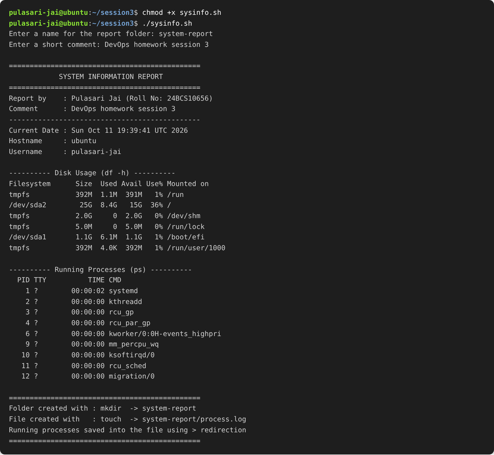
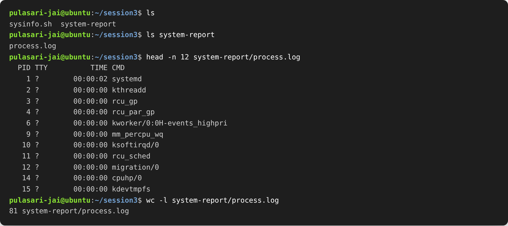

# Session 03 — Shell Scripting

**Name:** Pulasari Jai
**Roll No:** 24BCS10656

## Task

Create one shell script that prints system information and also practices the
basic shell scripting building blocks. The script must:

- print the current **date**
- print the **hostname**
- print the **username**
- print the **disk usage**
- print the **running processes**
- use **variables** to store and use data
- take user input using **`read -p`**
- create a directory using **`mkdir`**
- create a file using **`touch`**
- save the running processes into the file using **`>`** output redirection

## The script

The full script is in [`sysinfo.sh`](sysinfo.sh). Short version of what it does:

```bash
#!/bin/bash

# details stored in variables
name="Pulasari Jai"
roll_no="24BCS10656"

# take input from the user
read -p "Enter a name for the report folder: " folder_name
read -p "Enter a short comment: " comment

# store command output in variables
current_date=$(date)
host_name=$(hostname)
user_name=$(whoami)

# print the information
echo "Current Date : $current_date"
echo "Hostname     : $host_name"
echo "Username     : $user_name"

df -h              # disk usage
ps -e | head -n 10 # running processes

mkdir -p "$folder_name"               # create directory
touch "$folder_name/process.log"      # create file
ps -e > "$folder_name/process.log"    # save processes with > redirection
```

## How each requirement is covered

| Requirement | Where in the script |
|-------------|---------------------|
| Current date | `current_date=$(date)` |
| Hostname | `host_name=$(hostname)` |
| Username | `user_name=$(whoami)` |
| Disk usage | `df -h` |
| Running processes | `ps -e` |
| Variables | `name`, `roll_no`, `current_date`, `host_name`, `folder_name` ... |
| User input | `read -p "..." folder_name` and `read -p "..." comment` |
| `mkdir` | `mkdir -p "$folder_name"` |
| `touch` | `touch "$folder_name/process.log"` |
| `>` redirection | `ps -e > "$folder_name/process.log"` |

## How to run

```bash
chmod +x sysinfo.sh     # make the script executable
./sysinfo.sh            # run it
```

## Output

### 1. Running the script

The script first asks for two inputs (folder name and a comment), then prints the
full system report — date, hostname, username, disk usage and running processes.



### 2. Verifying the created folder and file

After the script runs, a folder is created with `mkdir`, an empty file is created with
`touch`, and the running processes are saved into it using `>` redirection. Here I check
that the folder and file exist and that the processes were really saved inside.



`wc -l` shows the `process.log` file has 81 lines — one line for every running process
that was saved by the `>` redirection.

## What I learned

- A variable in bash is set with `name=value` (no spaces) and used with `$name`.
- `$(command)` runs a command and stores its output in a variable (command substitution).
- `read -p "question" varname` asks the user and saves the answer.
- `mkdir` makes a folder, `touch` makes an empty file.
- `>` overwrites a file with command output, and `>>` would add to the end instead.
