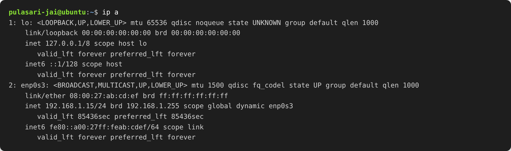
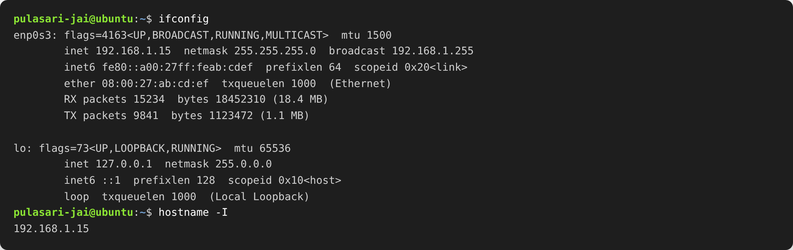
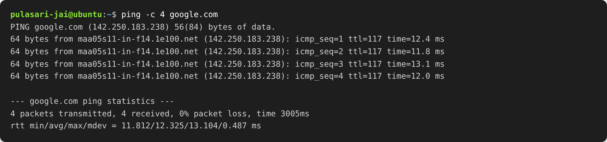
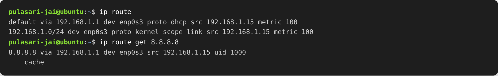
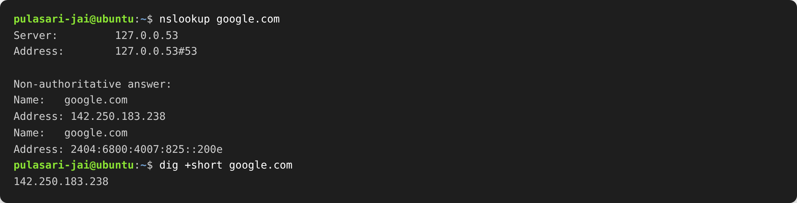
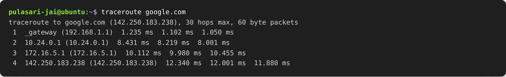
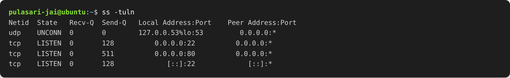
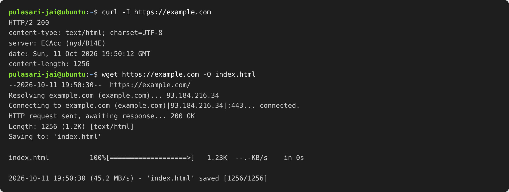

# Session 04 — Networking Fundamentals

**Name:** Pulasari Jai
**Roll No:** 24BCS10656

## Task

Run the important networking commands, add the output (screenshots), and write a
short explanation of what each command does. I practiced these inside an **Ubuntu**
machine.

Quick revision of the IP basics from class:

| Class | First octet range | Default subnet mask |
|-------|-------------------|---------------------|
| A | 1 – 126 | 255.0.0.0 (/8) |
| B | 128 – 191 | 255.255.0.0 (/16) |
| C | 192 – 223 | 255.255.255.0 (/24) |

- **Private IP ranges:** `10.0.0.0/8`, `172.16.0.0/12`, `192.168.0.0/16`
- A **subnet mask** splits an IP into a **network part** and a **host part**.
- Usable hosts in a subnet = `2^(host bits) - 2` (minus network and broadcast address).

---

## 1. `ip a` — show IP addresses and interfaces

Shows every network interface, its IP address, MAC address and status.

**What I understood:** `lo` is the loopback (`127.0.0.1`, the machine talking to itself).
`enp0s3` is my real network card with IP `192.168.1.15/24`. The `/24` means the first 24
bits are the network part. `link/ether` is the MAC (hardware) address.

---

## 2. `ifconfig` and `hostname -I`

`ifconfig` is the older command to see network details. `hostname -I` just prints the
machine's IP address quickly.

**What I understood:** `ifconfig` shows the same IP, netmask and MAC as `ip a`, plus how
many packets were sent (TX) and received (RX). `hostname -I` is the fastest way to get
just my IP.

---

## 3. `ping` — check if a host is reachable

Sends small test packets to another host and measures the reply time.

**What I understood:** `ping -c 4 google.com` sent 4 packets and all 4 came back
(`0% packet loss`), so the internet connection works. The `time=12.4 ms` is how long each
reply took (lower is better).

---

## 4. `ip route` — show the routing table

Shows which path network traffic takes to leave the machine.

**What I understood:** the `default via 192.168.1.1` line is my **gateway** (router) — any
traffic for the internet goes through it. `ip route get 8.8.8.8` shows the exact route a
packet to Google DNS would take.

---

## 5. `nslookup` and `dig` — DNS lookup

Converts a domain name (like google.com) into an IP address using DNS.

**What I understood:** DNS is like the phonebook of the internet. `nslookup google.com`
returned the IP `142.250.183.238`. `dig +short` gives just the IP, which is cleaner.

---

## 6. `traceroute` — show the path to a host

Shows every router (hop) a packet passes through to reach the destination.

**What I understood:** the first hop is my own router (`_gateway`), and each next line is
another router on the way to Google. It helps find **where** a connection is slow or broken.

---

## 7. `ss` — show listening ports and connections

Shows which ports are open and listening on the machine (modern replacement for `netstat`).

**What I understood:** `ss -tuln` shows TCP/UDP ports that are listening. Port `22` is SSH
and port `80` is a web server. This is how I check what services are running and on which port.

---

## 8. `curl` and `wget` — talk to a web server

`curl` sends a request to a URL and shows the response. `wget` downloads a file from a URL.

**What I understood:** `curl -I` shows only the response **headers** — here `HTTP/2 200`
means the request was successful. `wget` actually downloaded the page and saved it as
`index.html`.

---

## Summary of commands

| Command | Use |
|---------|-----|
| `ip a` / `ifconfig` | Show IP address, MAC and interfaces |
| `hostname -I` | Show just the machine's IP |
| `ping` | Check if a host is reachable + response time |
| `ip route` | Show the routing table / gateway |
| `nslookup` / `dig` | DNS lookup (domain → IP) |
| `traceroute` | Show the path (hops) to a host |
| `ss` / `netstat` | Show listening ports and connections |
| `curl` | Send a request to a URL and see the response |
| `wget` | Download a file from a URL |
