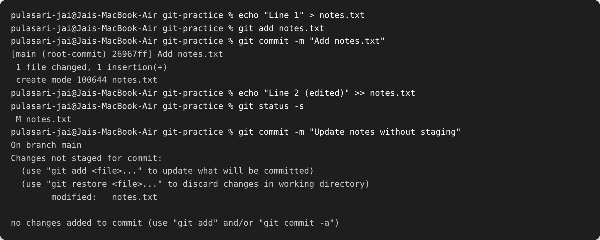
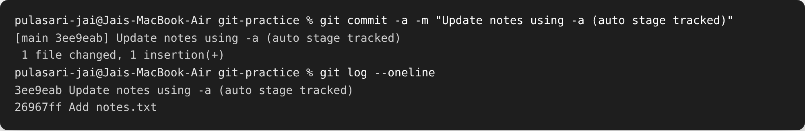
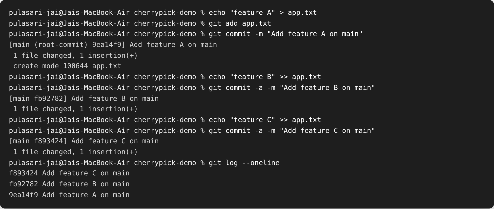
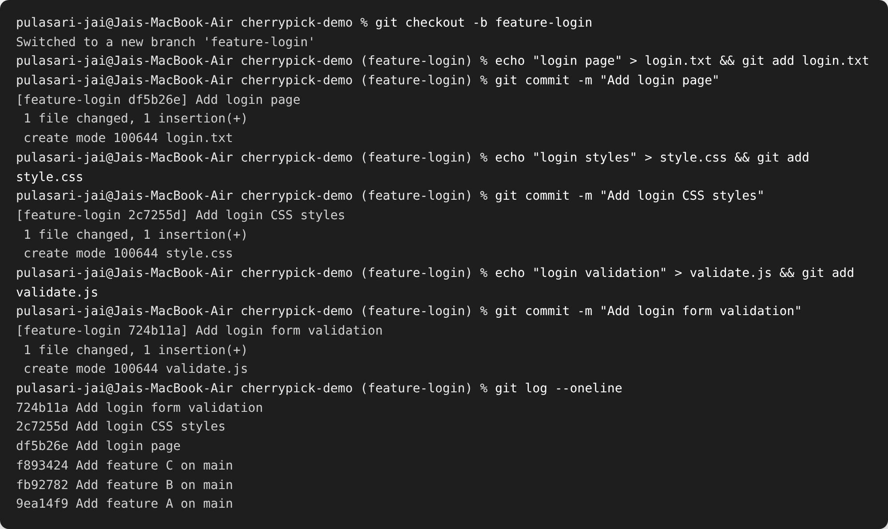
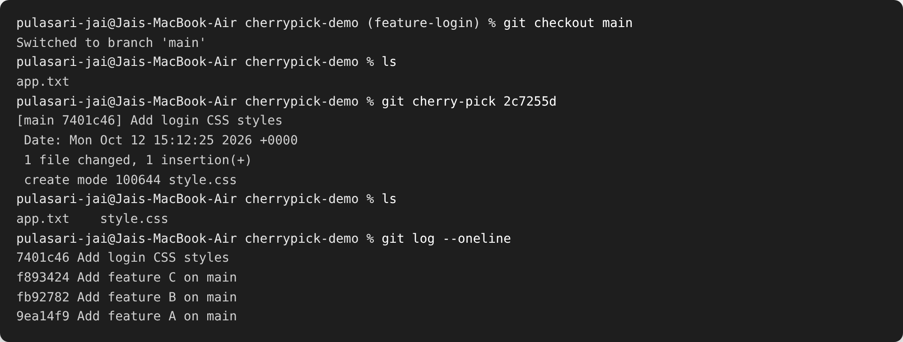

# Session 05 — Git / GitHub

**Name:** Pulasari Jai
**Roll No:** 24BCS10656

## Task 1 — `git commit -a -m` vs `git commit -m`

### The difference (in simple words)

| Command | What it does |
|---------|--------------|
| `git commit -m "msg"` | Commits **only what is already staged** (added with `git add`). If you changed a tracked file but did not `git add` it, nothing gets committed. |
| `git commit -a -m "msg"` | **Automatically stages all tracked files** that were modified or deleted, then commits them in one step. |

**Important:** `-a` only auto-stages files that git **already tracks**. A brand new
(untracked) file still needs `git add` first.

### Step 1 — Plain `git commit -m` without staging

First I create and commit a file. Then I edit the same file but try to commit **without**
staging it — git refuses and says *"no changes added to commit"*.

The `git status -s` shows ` M notes.txt` (M = modified but not staged). Because it was not
staged, `git commit -m` committed nothing.

### Step 2 — Same change with `git commit -a -m`

Now I run the same change using `-a`, which auto-stages the tracked file and commits it.

This time the commit worked (`[main 3ee9eab]`) and `git log --oneline` shows both commits.

### What I observed

- `git commit -m` needs me to run `git add` first.
- `git commit -a -m` skips the separate `git add` step for files git already tracks — but
  it will **not** pick up new untracked files.

---

## Task 2 — Git Cherry-Pick

**Goal:** take **one specific commit** from a feature branch and apply only that commit
onto `main`, without merging the whole branch.

### Step 1 — Create 2–4 commits on `main`

`git log --oneline` shows the three commits on `main`:
`9ea14f9`, `fb92782`, `f893424`.

### Step 2 — Create a new branch and make more commits

I create `feature-login` and make 3 commits on it. Then I use `git log` to find the
commit I want. Here I will cherry-pick the middle one — **`2c7255d` "Add login CSS styles"**.

### Step 3 — Cherry-pick that one commit into `main`

I switch back to `main` (where only `app.txt` exists) and cherry-pick commit `2c7255d`.

### Verify (before vs after)

| | Files on `main` | Top of `git log` |
|---|-----------------|------------------|
| **Before** | `app.txt` | `f893424 Add feature C on main` |
| **After** | `app.txt`, `style.css` | `7401c46 Add login CSS styles` |

- `style.css` (which was created on the feature branch) now exists on `main`.
- A **new commit `7401c46`** was created on `main` with the same message. The hash is
  **different** from the original `2c7255d`, because cherry-pick copies the change into a
  brand new commit — it does not move the original commit.
- The other feature-branch commits (`Add login page`, `Add login form validation`) were
  **not** brought over — only the one commit I picked.

### What I learned

- Cherry-pick is useful when I want just **one fix/feature** from another branch, not the
  whole branch.
- The cherry-picked commit gets a **new hash** on the target branch.
- Command used: `git cherry-pick <commit-hash>`.
