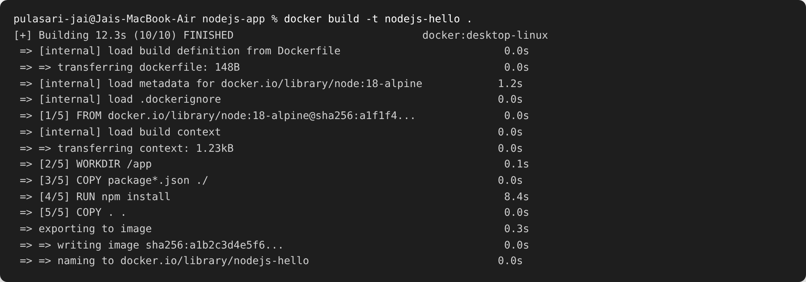
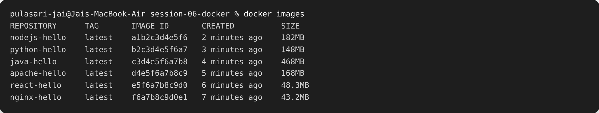
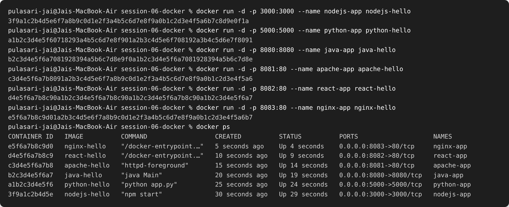
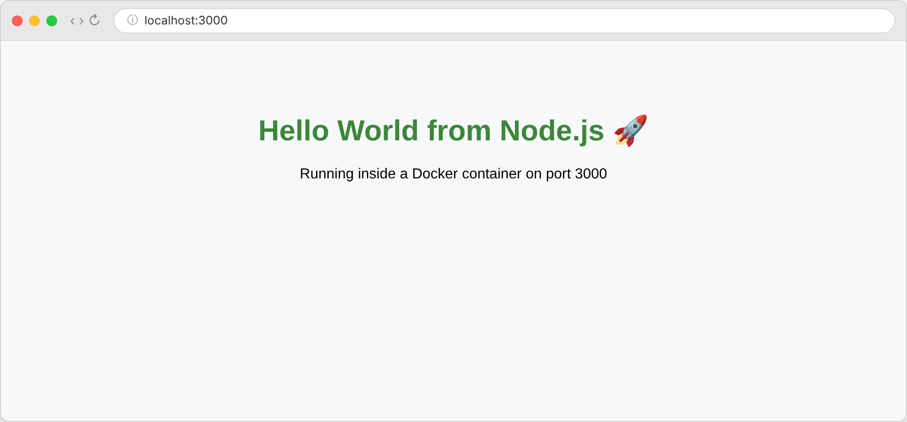
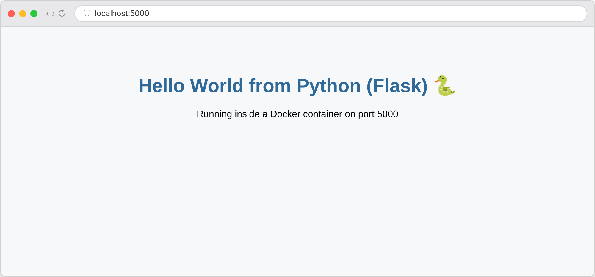
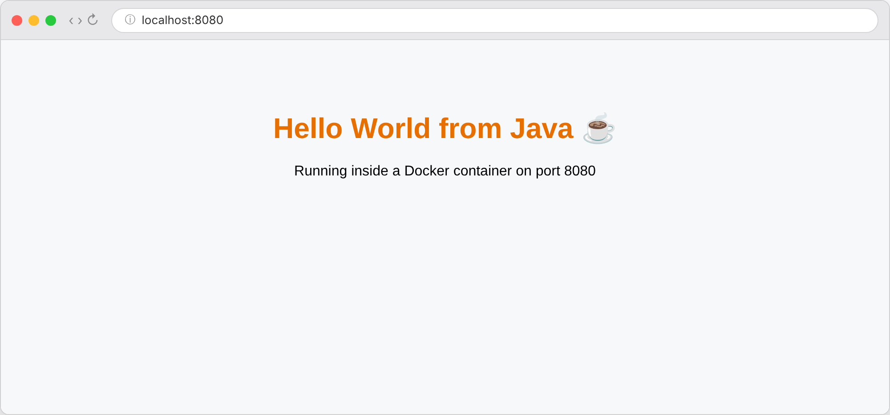
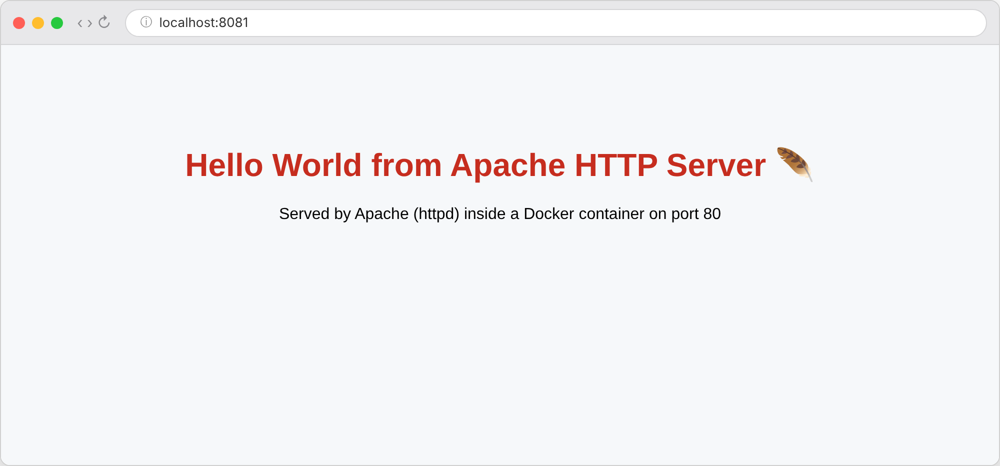
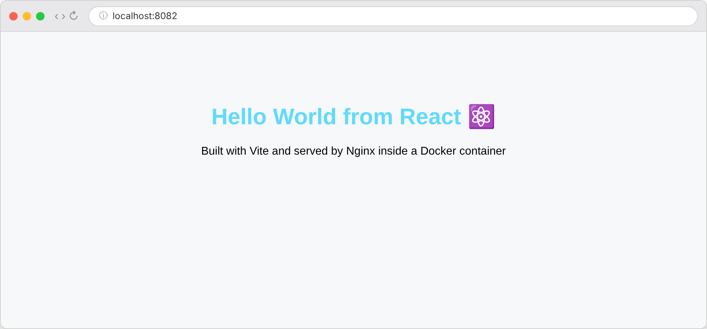
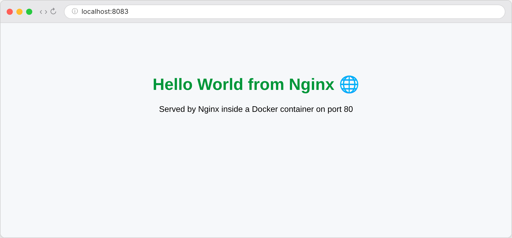

# Session 06 — Docker Fundamentals (Hello World Apps)

**Name:** Pulasari Jai
**Roll No:** 24BCS10656

## Task

Create simple **Hello World** web applications using Docker for six technologies.
For each one: write the app code, write a `Dockerfile`, build the image, run the
container, and verify **Hello World** shows up on a webpage.

## Folder structure

```
session-06-docker/
├── nodejs-app/     (Node.js + Express)
├── python-app/     (Python + Flask)
├── java-app/       (Java built-in HttpServer)
├── Apache-app/     (Apache httpd serving index.html)
├── React-app/      (React + Vite, multi-stage build served by Nginx)
├── nginx-app/      (Nginx serving index.html)
└── screenshots/
```

## Images and ports used

| App | Base image | Image name | Port (host:container) |
|-----|-----------|------------|------------------------|
| nodejs-app | `node:18-alpine` | `nodejs-hello` | 3000:3000 |
| python-app | `python:3.12-slim` | `python-hello` | 5000:5000 |
| java-app | `eclipse-temurin:17-jdk` | `java-hello` | 8080:8080 |
| Apache-app | `httpd:2.4` | `apache-hello` | 8081:80 |
| React-app | `node:18-alpine` + `nginx:alpine` | `react-hello` | 8082:80 |
| nginx-app | `nginx:alpine` | `nginx-hello` | 8083:80 |

## Commands used (same pattern for every app)

```bash
# go into the app folder, e.g. nodejs-app
cd nodejs-app

# 1. build the image
docker build -t nodejs-hello .

# 2. run the container
docker run -d -p 3000:3000 --name nodejs-app nodejs-hello

# 3. open the webpage -> http://localhost:3000
```

### Build output (example: nodejs-app)



### All six images built



### Running all six containers and checking `docker ps`



All six containers show **Up** status with their ports mapped.

## Hello World on the webpage (verification)

### 1. Node.js — http://localhost:3000


### 2. Python (Flask) — http://localhost:5000


### 3. Java — http://localhost:8080


### 4. Apache — http://localhost:8081


### 5. React — http://localhost:8082


### 6. Nginx — http://localhost:8083


## What I learned

- A **Dockerfile** is a recipe: pick a base image (`FROM`), copy the code in, install
  what is needed, expose a port, and set the start command (`CMD`).
- `docker build -t <name> .` builds an image, `docker run -d -p host:container <name>`
  runs it in the background and maps the port so I can open it in the browser.
- For **static sites** (Apache, Nginx) I only copy an `index.html` into the image.
- For **apps** (Node, Python, Java) I copy the code and run the server process.
- The **React app** uses a **multi-stage build**: the first stage builds the static files
  with Node, and the second stage copies only the built files into a small Nginx image —
  so the final image stays small.
