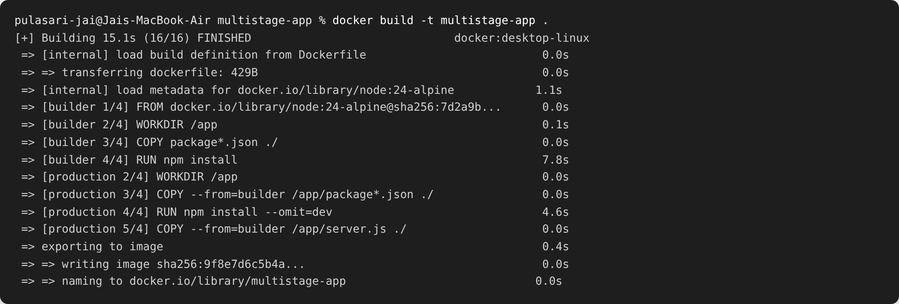
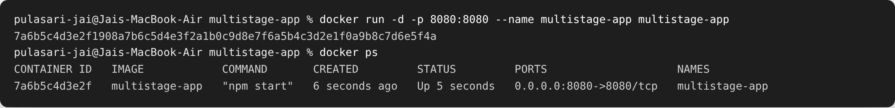
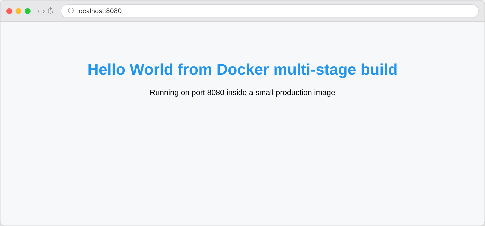
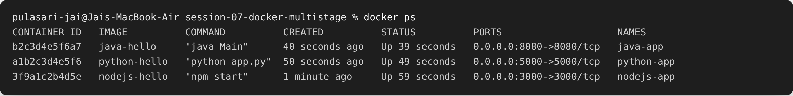

# Session 07 — Dockerfiles & Images (Multi-Stage Build)

**Name:** Pulasari Jai
**Enrollment / Roll No:** 24BCS10656

## Task 1 — Run a Multi-Stage Dockerfile

A **multi-stage build** uses more than one `FROM` in the same Dockerfile. The first
stage (builder) installs everything and builds the app. The second stage (production)
copies only what is needed from the builder, so the final image is **smaller and cleaner**.

### The multi-stage Dockerfile

```dockerfile
# Stage 1: Build
FROM node:24-alpine AS builder
WORKDIR /app
COPY package*.json ./
RUN npm install
COPY . .

# Stage 2: Production
FROM node:24-alpine AS production
WORKDIR /app
COPY --from=builder /app/package*.json ./
RUN npm install --omit=dev
COPY --from=builder /app/server.js ./
EXPOSE 8080
CMD ["npm", "start"]
```

### Build the image

```bash
cd multistage-app
docker build -t multistage-app .
```



You can see **two stages** in the build output: `builder` and `production`. Only the
final `production` stage becomes the image.

### Run the container (on port 8080)

```bash
docker run -d -p 8080:8080 --name multistage-app multistage-app
docker ps
```



`docker ps` confirms the container is **Up** and the application is running on port
**8080** (`0.0.0.0:8080->8080/tcp`).

### Verify the webpage — http://localhost:8080



The page shows: **Hello World from Docker multi-stage build** ✅

## Task 2 — Documentation

- **Name:** Pulasari Jai
- **Enrollment / Roll No:** 24BCS10656
- Screenshot of the running application: `screenshots/01-multistage-browser.png`
- Screenshot of `docker ps` on port 8080: `screenshots/03-docker-ps.png`

## Task 3 — Deploy 3 Different Types of Applications

To show Docker can run different kinds of apps, I deployed **three types** —
**Node.js**, **Python**, and **Java** (the same apps built in Session 06) — and checked
that all three run at the same time:

```bash
docker run -d -p 3000:3000 --name nodejs-app nodejs-hello
docker run -d -p 5000:5000 --name python-app python-hello
docker run -d -p 8080:8080 --name java-app   java-hello
docker ps
```



Three different application types are running as separate containers, each on its own port.

## What I learned

- A **multi-stage build** keeps build tools out of the final image, making it smaller.
- `COPY --from=builder` copies files from an earlier stage into the final stage.
- The same Docker workflow (`build` → `run` → open in browser) works for any language —
  Node.js, Python, or Java.
