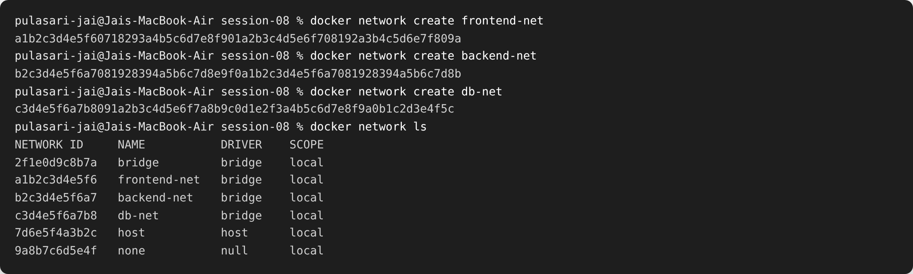
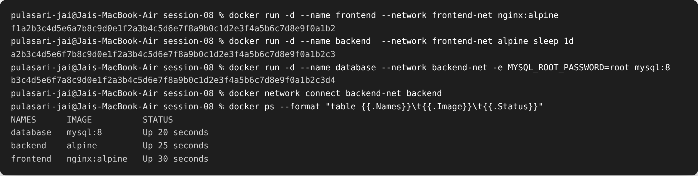
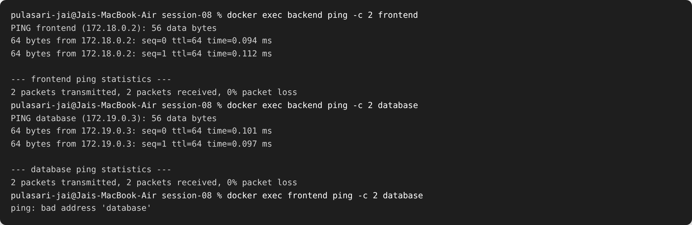
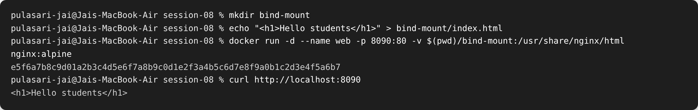

# Session 08 — Docker Networking & Volumes

**Name:** Pulasari Jai
**Roll No:** 24BCS10656

## Task 1 — Container Networking (frontend, backend, database)

I created 3 containers and 3 networks:

- **frontend** → `nginx:alpine` on `frontend-net`
- **backend** → `alpine` on **both** `frontend-net` and `backend-net`
- **database** → `mysql:8` on `backend-net`

### Step 1 — Create 3 networks



### Step 2 — Run the 3 containers and add backend to a 2nd network

```bash
docker run -d --name frontend --network frontend-net nginx:alpine
docker run -d --name backend  --network frontend-net alpine sleep 1d
docker run -d --name database --network backend-net -e MYSQL_ROOT_PASSWORD=root mysql:8

# add backend to a second network
docker network connect backend-net backend
```



### Step 3 — Check connectivity



**What I observed:**

- `backend` can ping **frontend** (they share `frontend-net`) ✅
- `backend` can ping **database** (they share `backend-net`) ✅
- `frontend` **cannot** ping `database` → `bad address 'database'` ❌
  because they are on **different networks** with no shared network.

This proves that containers can only talk to each other when they are on the **same
network**, and the backend works as a bridge because it is on two networks.

---

## Task 2 — Host Network (Apache on port 80)

With `--network host`, the container shares the host's network directly, so no `-p`
port mapping is needed. Apache is reachable straight away on port 80.

```bash
docker pull httpd:2.4
docker run -d --network host --name apache-host httpd:2.4
curl http://localhost:80
```


### Verify in the browser — http://localhost:80


The default Apache page **"It works!"** opens directly on port 80 using the host network.

---

## Task 3 — Bind Mount

A **bind mount** connects a folder on my computer to a folder inside the container. If I
edit the file on my machine, the change is seen instantly inside the container — no
rebuild or restart.

### Step 1 — Create the folder and file, then bind mount it to Nginx

```bash
mkdir bind-mount
echo "<h1>Hello students</h1>" > bind-mount/index.html
docker run -d --name web -p 8090:80 -v $(pwd)/bind-mount:/usr/share/nginx/html nginx:alpine
curl http://localhost:8090
```



### Verify in the browser — http://localhost:8090


### Step 2 — Modify the file and see the change live (no restart)

```bash
echo "<h1>Hello students - updated without restart!</h1>" > bind-mount/index.html
curl http://localhost:8090
```


The page updated **immediately** without restarting the container — this is the main
benefit of a bind mount.

---

## Task 4 — Overlay Network (research)

### What is an overlay network?

An **overlay network** lets containers running on **different Docker hosts (machines)**
talk to each other as if they were on the same local network. Docker builds a virtual
network **on top of** the real physical network (that is why it is called "overlay").

### How it works

- It is used with **Docker Swarm** (multiple Docker hosts joined into a cluster).
- Docker creates a virtual network that spans all the hosts.
- Traffic between hosts is wrapped (encapsulated) using **VXLAN**, so a container on
  Host A can reach a container on Host B by name.

### Use cases

- Running one application across **many servers** (a cluster).
- **Microservices** that run on different machines but need to talk to each other.
- Scaling services across multiple nodes while keeping simple service-name networking.

| Network type | Scope | Used for |
|--------------|-------|----------|
| bridge | single host | default container-to-container on one machine |
| host | single host | container uses the host's network directly |
| overlay | multiple hosts | containers across a Swarm cluster |

---

## Summary

- Containers talk only when on the **same network**; a container can join **multiple**
  networks (backend did).
- **Host network** skips port mapping and uses the host's ports directly.
- **Bind mounts** share a host folder with the container and update live.
- **Overlay networks** connect containers across multiple Docker hosts in a Swarm.
