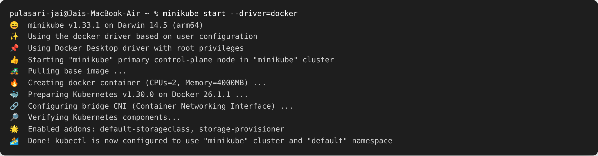
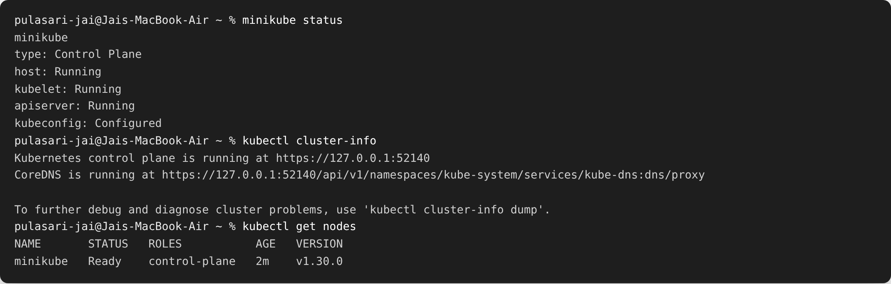
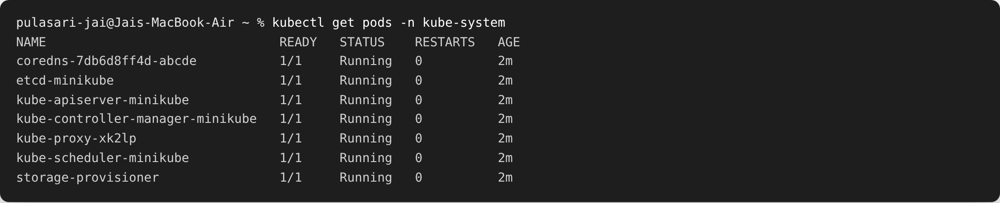
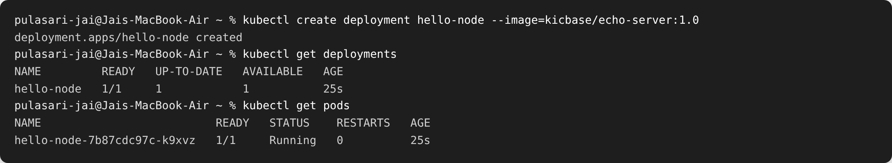
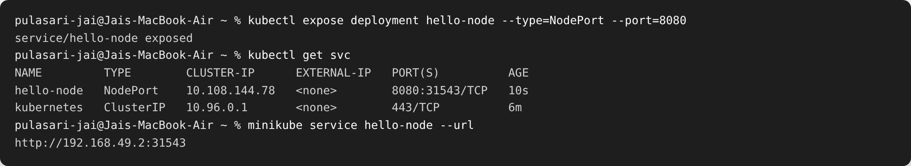
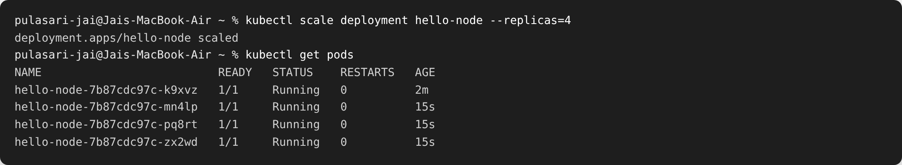

# Session 09 — Kubernetes Fundamentals

**Name:** Pulasari Jai
**Roll No:** 24BCS10656

## What is Kubernetes?

**Kubernetes (K8s)** is a tool that runs and manages containers across one or many
machines. It automatically handles **scaling**, **restarting failed containers**,
**load balancing**, and **rolling updates**. For practice I used **Minikube**, which
runs a small single-node Kubernetes cluster on my own laptop.

---

## Task 1 — Install and start Minikube

```bash
minikube start --driver=docker
```



Minikube created a single-node cluster using the Docker driver and configured `kubectl`
to talk to it.

---

## Task 2 — Verify the cluster status

```bash
minikube status
kubectl cluster-info
kubectl get nodes
```



- `minikube status` shows the control plane, kubelet and apiserver are **Running**.
- `kubectl get nodes` shows one node `minikube` in **Ready** state.

### Control-plane system pods

```bash
kubectl get pods -n kube-system
```



These are the Kubernetes system components running as pods (apiserver, etcd, scheduler,
controller-manager, coredns, kube-proxy).

---

## Task 3 — Kubernetes Architecture (short notes)

A Kubernetes cluster has two main parts: the **Control Plane** (the brain) and the
**Worker Nodes** (where apps run).

### Control Plane components

| Component | Job |
|-----------|-----|
| **kube-apiserver** | Front door of the cluster — all commands go through it |
| **etcd** | Key-value database that stores the whole cluster state |
| **kube-scheduler** | Decides which node a new pod should run on |
| **kube-controller-manager** | Keeps the actual state matching the desired state (restarts pods, etc.) |

### Worker Node components

| Component | Job |
|-----------|-----|
| **kubelet** | Agent on each node that starts/stops pods and reports status |
| **kube-proxy** | Handles networking and routing to pods |
| **Container runtime** | Actually runs the containers (e.g. Docker / containerd) |

**Flow:** I run `kubectl` → it talks to the **apiserver** → the **scheduler** picks a node
→ the **kubelet** on that node starts the pod → **etcd** stores the state.

---

## Task 4 — Basic Kubernetes objects and commands

### Basic objects

| Object | What it is |
|--------|------------|
| **Pod** | Smallest unit — one or more containers running together |
| **ReplicaSet** | Keeps a fixed number of identical pods running |
| **Deployment** | Manages ReplicaSets, handles updates and rollbacks |
| **Service** | Stable network address to reach a group of pods |
| **Namespace** | A way to group and separate resources |

### Common commands

| Command | Use |
|---------|-----|
| `kubectl get pods` | List pods |
| `kubectl get nodes` | List nodes |
| `kubectl describe pod <name>` | Detailed info about a pod |
| `kubectl logs <pod>` | View pod logs |
| `kubectl apply -f file.yaml` | Create/update from a YAML file |
| `kubectl delete <type> <name>` | Delete a resource |

---

## Task 5 — Kubernetes Basics tutorial (hands-on)

### Create a deployment

```bash
kubectl create deployment hello-node --image=kicbase/echo-server:1.0
kubectl get deployments
kubectl get pods
```



### Expose it as a Service and get the URL

```bash
kubectl expose deployment hello-node --type=NodePort --port=8080
kubectl get svc
minikube service hello-node --url
```



### Scale the deployment to 4 pods

```bash
kubectl scale deployment hello-node --replicas=4
kubectl get pods
```



Kubernetes created 3 more pods automatically to reach the requested **4 replicas**.

---

## What I learned

- Minikube gives a full Kubernetes cluster on one laptop for practice.
- The **control plane** decides and stores; the **worker node** runs the pods.
- A **Deployment** manages pods for me — if I ask for 4 replicas, Kubernetes keeps 4 running.
- A **Service** gives a stable way to reach those pods from outside.
