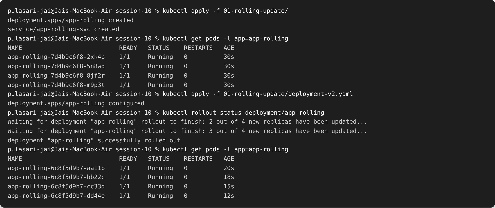
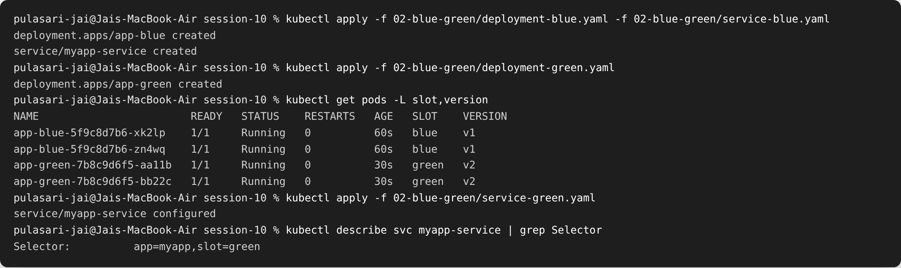
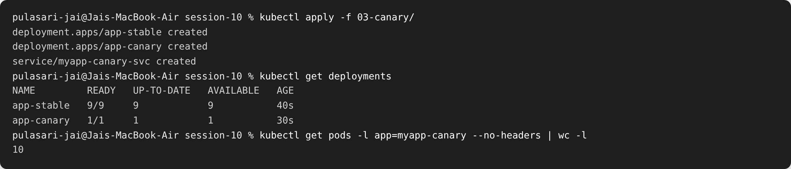
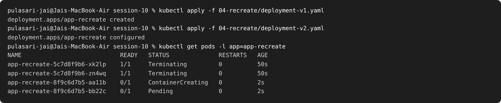
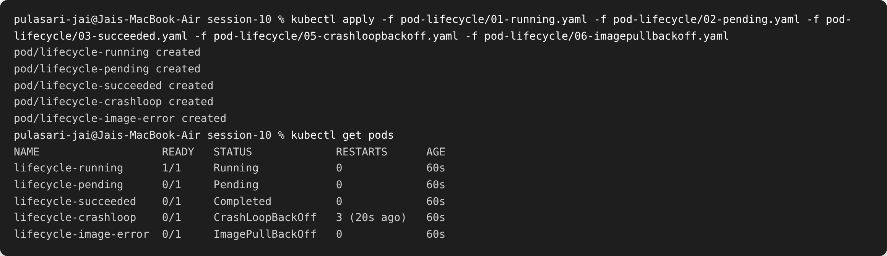
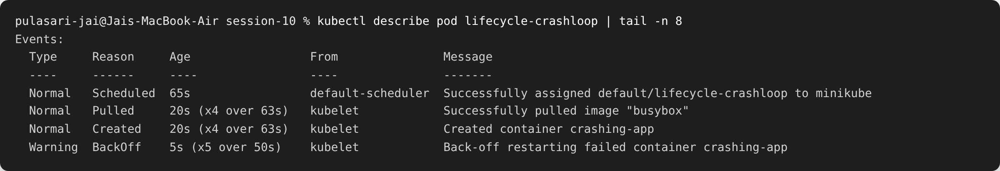

# Session 10 — Kubernetes Pods, ReplicaSets & Deployments

**Name:** Pulasari Jai
**Roll No:** 24BCS10656

## Task 1 — Deployment Strategies

I implemented all **4 deployment strategies**. YAML files are in the folders
`01-rolling-update/`, `02-blue-green/`, `03-canary/`, `04-recreate/`.

### 1. Rolling Update

Replaces old pods **one by one** with new ones, so the app never goes down.

```bash
kubectl apply -f 01-rolling-update/
kubectl apply -f 01-rolling-update/deployment-v2.yaml   # update image v1 -> v2
kubectl rollout status deployment/app-rolling
```



**Observed:** the old pods (hash `7d4b9c6f8`, v1) were slowly replaced by new pods
(hash `6c8f5d9b7`, v2). The rollout finished with **zero downtime**.

### 2. Blue-Green Deployment

Run **two versions** at once (blue = v1, green = v2). Switch all traffic instantly by
changing the Service selector from `slot: blue` to `slot: green`.

```bash
kubectl apply -f 02-blue-green/deployment-blue.yaml -f 02-blue-green/service-blue.yaml
kubectl apply -f 02-blue-green/deployment-green.yaml
kubectl apply -f 02-blue-green/service-green.yaml      # THE SWITCH
```



**Observed:** both blue and green pods were running. After applying `service-green.yaml`,
the Service selector flipped to `slot=green`, so **all traffic instantly went to v2**.
If v2 has a problem, I can switch back to blue just as fast.

### 3. Canary Deployment

Send a **small percentage** of traffic to the new version. Here 9 stable pods + 1 canary
pod means about **10%** of traffic hits the canary (the Service selects both with the
common label `app=myapp-canary`).

```bash
kubectl apply -f 03-canary/
kubectl get deployments
```



**Observed:** `app-stable` has 9 pods and `app-canary` has 1 pod. Because the Service
matches both, roughly 1 in 10 requests goes to the new canary version. If it looks good,
I scale the canary up; if not, I delete it.

### 4. Recreate Deployment

Kills **all old pods first**, then creates new ones. This causes **downtime** but is
simple.

```bash
kubectl apply -f 04-recreate/deployment-v1.yaml
kubectl apply -f 04-recreate/deployment-v2.yaml
kubectl get pods -l app=app-recreate
```



**Observed:** the old pods go to **Terminating** *before* the new pods are
**ContainerCreating** — so there is a short moment with no running pods (downtime).

### Strategy comparison

| Strategy | Downtime? | Two versions at once? | Good for |
|----------|-----------|------------------------|----------|
| Rolling Update | No | Briefly (during update) | Default, safe updates |
| Blue-Green | No | Yes (full copies) | Instant switch / rollback |
| Canary | No | Yes (small %) | Testing on real traffic |
| Recreate | **Yes** | No | Apps that can't run 2 versions |

---

## Task 2 — Pod Lifecycle

I applied several pod YAMLs from `pod-lifecycle/` and checked their status to see the
different lifecycle states a pod can be in.

```bash
kubectl apply -f pod-lifecycle/01-running.yaml -f pod-lifecycle/02-pending.yaml \
  -f pod-lifecycle/03-succeeded.yaml -f pod-lifecycle/05-crashloopbackoff.yaml \
  -f pod-lifecycle/06-imagepullbackoff.yaml
kubectl get pods
```



### What each status means

| Pod | Status | Why |
|-----|--------|-----|
| lifecycle-running | **Running** | Container started and is healthy |
| lifecycle-pending | **Pending** | Can't be scheduled (asks for impossible resources) |
| lifecycle-succeeded | **Completed** | Job finished with exit code 0 |
| lifecycle-crashloop | **CrashLoopBackOff** | Container keeps crashing and restarting |
| lifecycle-image-error | **ImagePullBackOff** | The image name is wrong / can't be pulled |

### Investigating a failing pod with `describe`

```bash
kubectl describe pod lifecycle-crashloop
```



**Observed:** the Events at the bottom show `Back-off restarting failed container`, which
tells me the container started but exited, and Kubernetes keeps retrying with a growing
delay — that is what **CrashLoopBackOff** means.

---

## What I learned

- A **Deployment** manages **ReplicaSets**, which manage **Pods**. I change the Deployment
  and Kubernetes handles the pods for me.
- Each deployment strategy is a trade-off between **downtime**, **speed of rollback**, and
  **risk**.
- `kubectl get pods` shows the status, and `kubectl describe pod` shows the **Events**,
  which is the first place to look when a pod is not Running.
