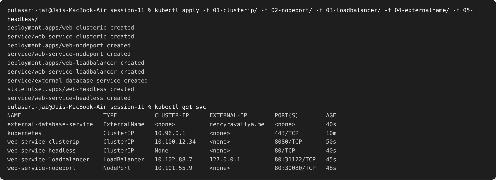
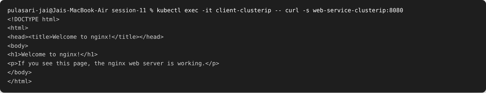
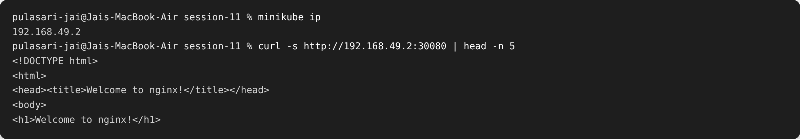
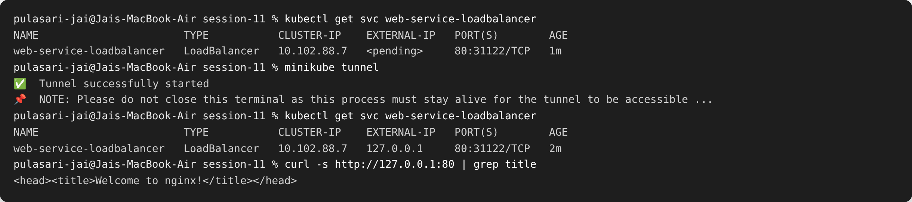
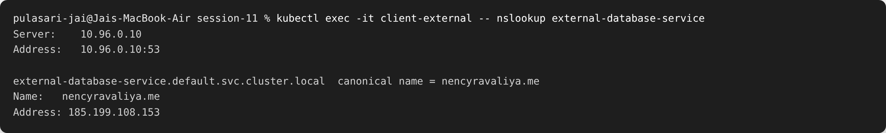
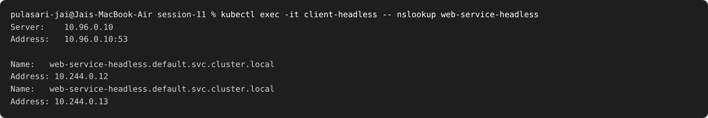

# Session 11 — Kubernetes Networking & Services

**Name:** Pulasari Jai
**Roll No:** 24BCS10656

## Task 1 — The 5 Service Types

A **Service** gives pods a stable name and IP, because pods come and go and their IPs
change. I deployed and tested all 5 service types. YAMLs are in `01-clusterip/` …
`05-headless/`.

### All 5 services deployed

```bash
kubectl apply -f 01-clusterip/ -f 02-nodeport/ -f 03-loadbalancer/ -f 04-externalname/ -f 05-headless/
kubectl get svc
```



### 1. ClusterIP (internal only)

Default type. Reachable **only inside** the cluster. Tested from another pod:



### 2. NodePort (opens a port on the node)

Opens a fixed port (30080) on the node so it can be reached from **outside** using the
node IP.



### 3. LoadBalancer (external IP)

Asks the cloud/minikube for an **external IP**. On minikube I used `minikube tunnel` to
get the `EXTERNAL-IP`.



### 4. ExternalName (alias to an external domain)

Does not point to pods — it is a **DNS alias** (CNAME) to an outside domain.



### 5. Headless (no cluster IP, returns pod IPs)

`clusterIP: None`. DNS returns the **individual pod IPs** instead of one service IP —
used with StatefulSets (databases).



### Service type summary

| Type | Reachable from | Gives |
|------|----------------|-------|
| ClusterIP | inside cluster only | one internal IP |
| NodePort | outside, via node IP + port | node port (30000–32767) |
| LoadBalancer | outside, via external IP | cloud load balancer IP |
| ExternalName | DNS alias | CNAME to external domain |
| Headless | inside cluster | the pods' own IPs (no single IP) |

---

## Task 2 — Kubernetes Object Comparison

### Deployment vs ReplicaSet

| Point | ReplicaSet | Deployment |
|-------|-----------|------------|
| Purpose | Keep N identical pods running | Manage ReplicaSets + updates |
| Pod management | Creates/replaces pods | Does it through a ReplicaSet |
| Scaling | Yes (`replicas`) | Yes |
| Rolling updates | **No** | **Yes** (rollout, rollback) |
| Relationship | Lower level | Creates and controls ReplicaSets |

**In short:** we almost always use a **Deployment**. It creates a ReplicaSet under the
hood, and adds rolling updates and rollbacks on top.

### Deployment vs DaemonSet vs StatefulSet

| Point | Deployment | DaemonSet | StatefulSet |
|-------|-----------|-----------|-------------|
| Use case | Stateless apps (web, API) | One pod **per node** (logs, monitoring) | Stateful apps (databases) |
| Pod creation | Any node, random names | One on every node | Ordered, fixed names (web-0, web-1) |
| Scaling | Add/remove freely | Follows number of nodes | Ordered scale up/down |
| Networking | Via Service | Via node | **Stable network ID** (headless svc) |
| Storage | Shared / none | Node-local | **Own stable volume per pod** |
| Example | nginx web app | node-exporter, fluentd | MySQL, Kafka |

### ReplicaSet vs Service

| ReplicaSet | Service |
|------------|---------|
| **Runs and keeps pods alive** | **Gives a stable address to reach pods** |
| Cares about pod count | Cares about networking/traffic |
| Pods have changing IPs | Service IP/name stays the same |

**Why a Service is needed:** pods restart and get new IPs. A Service keeps one stable
name/IP and automatically forwards traffic to the healthy pods behind it (using labels).
**How traffic reaches pods:** client → Service (stable IP) → matches pods by **label
selector** → forwards to a pod.

See [`fqdn/README.md`](fqdn/README.md) and [`coredns/README.md`](coredns/README.md) for
Tasks 3 and 4.
