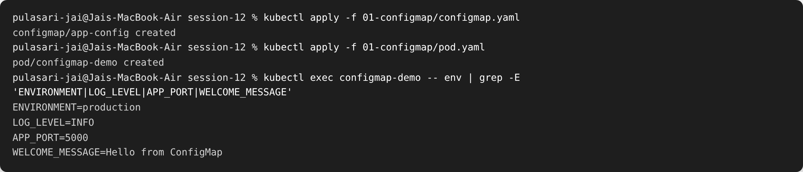
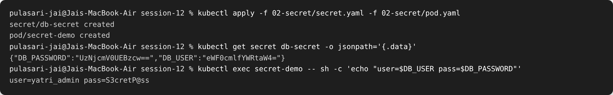
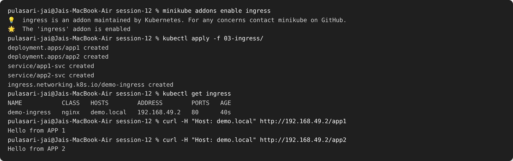
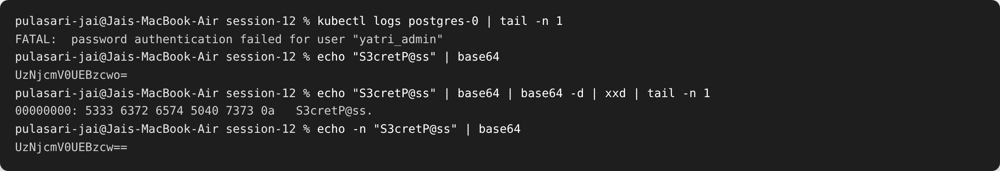

# Session 12 — Kubernetes Ingress, ConfigMaps & Secrets

**Name:** Pulasari Jai
**Roll No:** 24BCS10656

## Task 1 — ConfigMap

A **ConfigMap** stores **non-secret** configuration (like settings and environment
values) separately from the app, so I can change config without rebuilding the image.

```bash
kubectl apply -f 01-configmap/configmap.yaml
kubectl apply -f 01-configmap/pod.yaml
kubectl exec configmap-demo -- env | grep -E 'ENVIRONMENT|LOG_LEVEL|APP_PORT|WELCOME_MESSAGE'
```



**Observed:** the pod used `envFrom.configMapRef`, so all the ConfigMap keys appeared as
environment variables **inside the container** (`ENVIRONMENT=production`, etc.).

---

## Task 2 — Secret

A **Secret** is like a ConfigMap but for **sensitive** data (passwords, tokens). The
values are stored **base64-encoded**.

```bash
kubectl apply -f 02-secret/secret.yaml -f 02-secret/pod.yaml
kubectl get secret db-secret -o jsonpath='{.data}'     # shows base64 values
kubectl exec secret-demo -- sh -c 'echo "user=$DB_USER pass=$DB_PASSWORD"'
```



**Observed:** `kubectl get secret` shows the values **base64-encoded**
(`eWF0cmlfYWRtaW4=`), but inside the pod they are **decoded automatically** to the real
values (`user=yatri_admin pass=S3cretP@ss`).

### Why Secrets should not be committed to Git

- **base64 is NOT encryption** — anyone can decode it instantly
  (`echo eWF0cmlfYWRtaW4= | base64 -d` → `yatri_admin`).
- If the secret YAML is pushed to GitHub, the password is basically public.
- Instead: keep secrets **out of Git** (use `.gitignore`), or use tools like
  **Sealed Secrets**, **Vault**, or the cloud provider's secret manager.

---

## Task 3 — Ingress

An **Ingress** gives one entry point and routes traffic to different services based on the
**path** or **host**. Here `/app1` goes to app1 and `/app2` goes to app2.

```bash
minikube addons enable ingress
kubectl apply -f 03-ingress/
kubectl get ingress
curl -H "Host: demo.local" http://192.168.49.2/app1
curl -H "Host: demo.local" http://192.168.49.2/app2
```



**Observed:** the same IP and host (`demo.local`) returned **different apps** depending on
the path — `/app1` → "Hello from APP 1", `/app2` → "Hello from APP 2". That is path-based
routing working through the Ingress.

---

## Task 4 — Ingress vs Ingress Controller

### What is an Ingress?

An **Ingress** is just a set of **routing rules** (a YAML object). It says *"traffic for
`/app1` goes to app1-svc"*. By itself it does nothing — it is only the rulebook.

### What is an Ingress Controller?

An **Ingress Controller** is the actual **software (a pod)** that reads those rules and
does the real routing — for example **NGINX Ingress Controller**. Without a controller,
an Ingress resource has no effect.

### Difference

| Ingress | Ingress Controller |
|---------|--------------------|
| A rule object (YAML) | A running program (pod) |
| Says *what* should route where | Actually *does* the routing |
| You write it | It watches and applies your rules |

### Why both are required

The Ingress is the **rules**; the controller is the **engine** that enforces them. You
need both: rules with no engine do nothing, and an engine with no rules has nothing to do.

### Example

- Ingress rule: `demo.local/app1 → app1-svc`
- Ingress Controller (NGINX): sees that rule and forwards matching requests to `app1-svc`.

---

## Task 5 — Troubleshooting (the base64 newline bug)

**Problem:** PostgreSQL rejected the app with
`FATAL: password authentication failed for user "yatri_admin"` even though the password
"looked" correct.

### Investigation

```bash
kubectl logs postgres-0 | tail -n 1          # see the auth error
echo "S3cretP@ss" | base64                   # how the secret was (wrongly) made
```



### Root cause

The secret was created with `echo "S3cretP@ss" | base64` (without `-n`). Plain `echo`
adds a hidden **newline (`\n`)** at the end, so the stored password was actually
`S3cretP@ss\n` (11 chars) — the database rejected it.

- Wrong: `echo "S3cretP@ss" | base64` → `UzNjcmV0UEBzcwo=` (ends in `o=`, has the newline)
- Right: `echo -n "S3cretP@ss" | base64` → `UzNjcmV0UEBzcw==` (ends in `==`, no newline)

### Fix

Recreate the secret using `echo -n` (or `kubectl create secret ... --from-literal`), then
restart the pod. Authentication then succeeds.

**Before:** `FATAL: password authentication failed`
**After:** login works, because the password no longer has the extra `\n`.

(Full write-up: [`troubleshooting/secret-base64-gotcha.md`](troubleshooting/secret-base64-gotcha.md))

---

## What I learned

- **ConfigMap** = non-secret config, **Secret** = sensitive data (base64, not encrypted).
- Both can be injected into pods as **environment variables** or files.
- **Ingress** routes outside traffic to services by path/host, but needs an **Ingress
  Controller** to actually work.
- Always use `echo -n` when base64-encoding secrets, or a hidden newline breaks logins.
