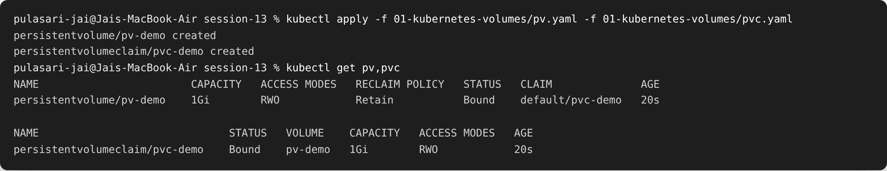
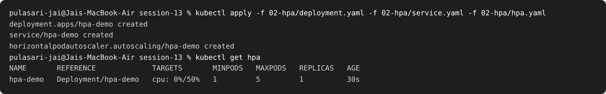
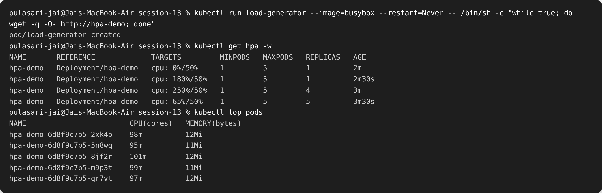
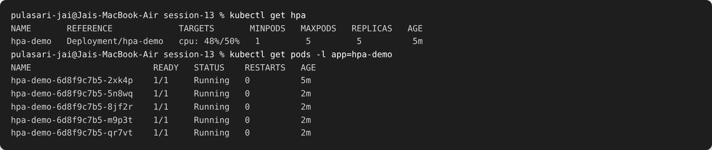
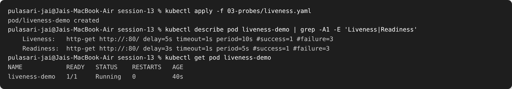

# Session 13 — Kubernetes Storage, HPA & Probes

**Name:** Pulasari Jai
**Roll No:** 24BCS10656

## Task 1 — Kubernetes Volumes

Full write-up with examples is in
[`01-kubernetes-volumes/README.md`](01-kubernetes-volumes/README.md). It covers
**emptyDir, hostPath, PersistentVolume, PersistentVolumeClaim, StorageClass, and dynamic
provisioning** with YAML examples.

### PV / PVC binding (demo)

```bash
kubectl apply -f 01-kubernetes-volumes/pv.yaml -f 01-kubernetes-volumes/pvc.yaml
kubectl get pv,pvc
```



**Observed:** the PVC `pvc-demo` got **Bound** to the PV `pv-demo`, so the storage is
reserved and ready for a pod to use.

---

## Task 2 — HPA (Horizontal Pod Autoscaler) Hands-on

The **HPA** automatically adds or removes pods based on CPU usage. My HPA keeps CPU around
**50%**, with **min 1** and **max 5** pods.

### Step 1 — Deploy the app and the HPA

```bash
kubectl apply -f 02-hpa/deployment.yaml -f 02-hpa/service.yaml -f 02-hpa/hpa.yaml
kubectl get hpa
```



At rest, CPU is `0%/50%` and there is **1 replica**.

### Step 2 — Generate load and watch it scale

```bash
kubectl run load-generator --image=busybox --restart=Never -- \
  /bin/sh -c "while true; do wget -q -O- http://hpa-demo; done"
kubectl get hpa -w
kubectl top pods
```



**Observed:** CPU jumped to `180%` → `250%`, so the HPA increased replicas from 1 → 4 → 5.
`kubectl top pods` shows all pods sharing the CPU load.

### Step 3 — Fully scaled

```bash
kubectl get hpa
kubectl get pods -l app=hpa-demo
```



**Observed:** the deployment reached **5 pods** (the max), and CPU settled back near the
50% target because the load is now shared. If I stop the load, the HPA scales back down to
1 pod after a cool-down.

---

## Task 3 — Probes (bonus) & Mini Project

### Probes

Probes let Kubernetes check pod health:

| Probe | Question it answers | If it fails |
|-------|---------------------|-------------|
| **Liveness** | Is the app still alive? | restart the container |
| **Readiness** | Is the app ready for traffic? | remove it from the Service |
| **Startup** | Has the app finished starting? | wait before other probes run |

```bash
kubectl apply -f 03-probes/liveness.yaml
kubectl describe pod liveness-demo | grep -A1 -E 'Liveness|Readiness'
```



### Mini Project

The `mini-project/` folder brings it together in one namespace: a **Deployment** with a
**PVC** (storage), a **Service**, and an **HPA** (autoscaling).

```bash
kubectl apply -f mini-project/namespace.yaml
kubectl apply -f mini-project/
```

Files: `namespace.yaml`, `deployment.yaml`, `service.yaml`, `pvc.yaml`, `hpa.yaml`.

---

## What I learned

- **Volumes** keep data alive beyond the pod; **PV + PVC** give real persistent storage,
  and **StorageClass** can create volumes automatically (dynamic provisioning).
- The **HPA** watches CPU and adds/removes pods automatically — I saw it scale 1 → 5 under
  load and it needs `metrics-server` + resource `requests` to work.
- **Probes** keep apps healthy: liveness restarts dead apps, readiness stops traffic to
  pods that aren't ready.
