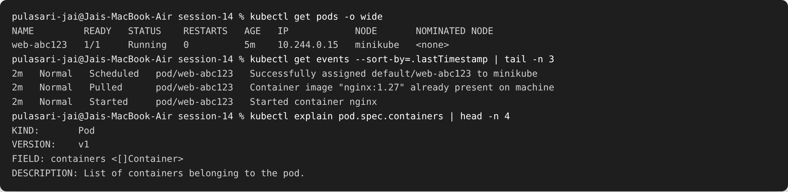
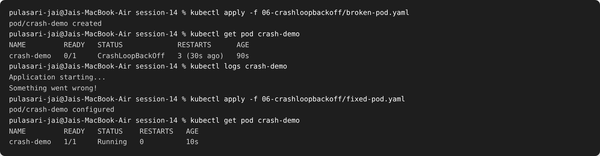
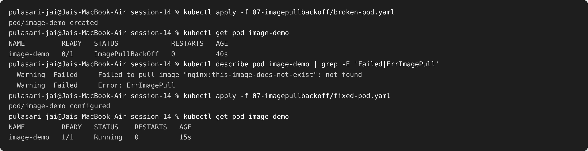
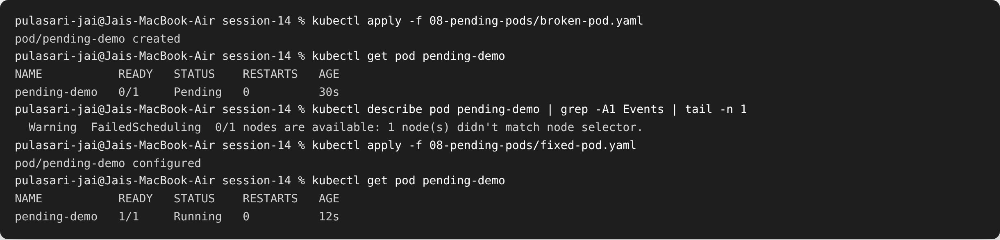
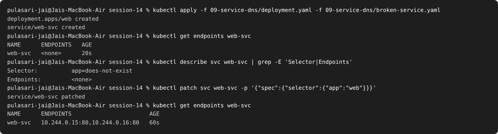

# Session 14 — Kubernetes Troubleshooting

**Name:** Pulasari Jai
**Roll No:** 24BCS10656

## Task 1 — Troubleshooting commands

These are the main commands I used to find and fix problems.

| Command | What it shows |
|---------|---------------|
| `kubectl get pods -o wide` | Pod status + IP + which node it is on |
| `kubectl describe pod <name>` | Full details + **Events** (the #1 place to look) |
| `kubectl logs <pod>` | The app's output / error messages |
| `kubectl exec -it <pod> -- sh` | A shell inside the container to test things |
| `kubectl get events --sort-by=.lastTimestamp` | Recent cluster events |
| `kubectl top pods` | CPU / memory usage |
| `kubectl explain <resource>` | Docs for a field, directly in the terminal |

---

## Task 2 — Troubleshooting common issues

For each issue I followed the same steps: **identify → investigate → root cause → fix →
verify**. Broken and fixed YAMLs are in the numbered folders.

### 1. CrashLoopBackOff

- **Identify:** `kubectl get pod` shows `CrashLoopBackOff` with rising restarts.
- **Investigate:** `kubectl logs crash-demo` shows `Something went wrong!` then exit.
- **Root cause:** the container command runs `exit 1`, so it keeps crashing and Kubernetes
  keeps restarting it.
- **Fix:** change the command so it runs successfully (stays alive).
- **Verify:** pod becomes `Running` with 0 restarts.

### 2. ImagePullBackOff / ErrImagePull

- **Identify:** pod stuck in `ImagePullBackOff`.
- **Investigate:** `kubectl describe pod` shows `Failed to pull image ... not found` →
  `ErrImagePull`.
- **Root cause:** the image name/tag is wrong (`nginx:this-image-does-not-exist`).
- **Fix:** use a correct image tag (e.g. `nginx:1.27`).
- **Verify:** pod pulls the image and becomes `Running`.

### 3. Pending / ContainerCreating

- **Identify:** pod stays `Pending` and is never scheduled.
- **Investigate:** `kubectl describe pod` shows
  `FailedScheduling ... didn't match node selector`.
- **Root cause:** the pod has a `nodeSelector` for a node that does not exist.
- **Fix:** remove or correct the `nodeSelector`.
- **Verify:** pod gets scheduled and becomes `Running`.

> **ContainerCreating** is a normal short step (pulling image / mounting volumes). It is a
> *problem* only if it is stuck — then `describe` usually shows a volume or image issue.

### 4. Service connectivity / DNS issue

- **Identify:** the app can't be reached through the Service.
- **Investigate:** `kubectl get endpoints web-svc` shows `<none>` (no pods behind it).
  `kubectl describe svc` shows `Selector: app=does-not-exist`.
- **Root cause:** the Service **selector does not match the pod labels** (`app=web`), so it
  has no endpoints and traffic goes nowhere.
- **Fix:** correct the selector to `app=web`.
- **Verify:** `kubectl get endpoints` now lists the pod IPs, and the Service works.

### Quick reference — status → likely cause

| Status | Likely cause | First command |
|--------|--------------|---------------|
| CrashLoopBackOff | app crashes on start | `kubectl logs` |
| ImagePullBackOff / ErrImagePull | wrong image name/tag or no access | `kubectl describe pod` |
| Pending | no node fits (resources / selector) | `kubectl describe pod` |
| ContainerCreating (stuck) | volume / secret / image problem | `kubectl describe pod` |
| Service not reachable | selector doesn't match pods | `kubectl get endpoints` |
| DNS failure | CoreDNS down or wrong name | `kubectl exec ... nslookup` |

---

## Task 3 — Mini Project

The `mini-project/` folder has a deployment, a service, and a **broken pod** to debug
together. Steps I followed:

1. `kubectl apply -f mini-project/` and `kubectl get pods` → find the broken one.
2. `kubectl describe` / `kubectl logs` on the broken pod to read the Events.
3. Identify the root cause (bad image / command / selector).
4. Fix the YAML and re-apply.
5. `kubectl get pods` to confirm everything is `Running`.

---

## What I learned

- **`kubectl describe` Events** and **`kubectl logs`** solve most problems — always start
  there.
- The **pod status itself** (CrashLoopBackOff, ImagePullBackOff, Pending) already tells you
  roughly what is wrong.
- A Service with **no endpoints** almost always means the **selector doesn't match the pod
  labels**.
