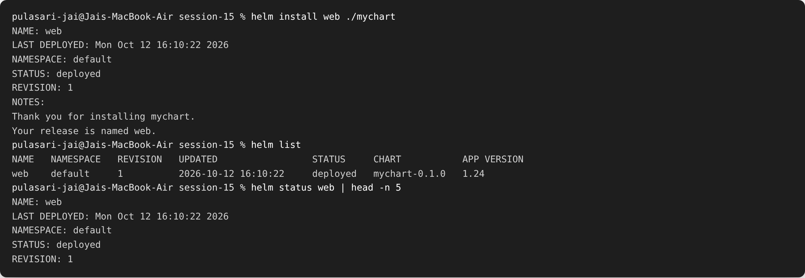
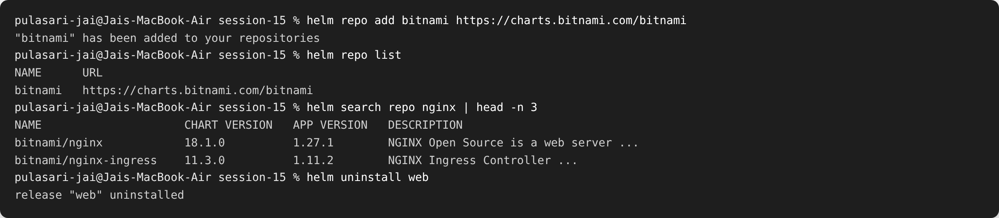
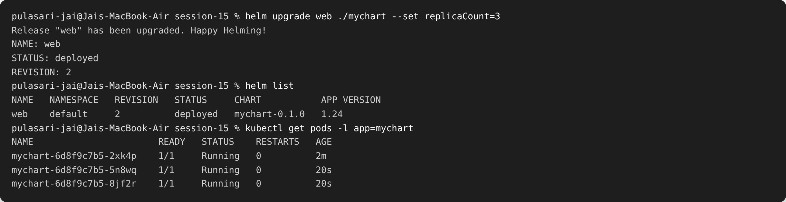
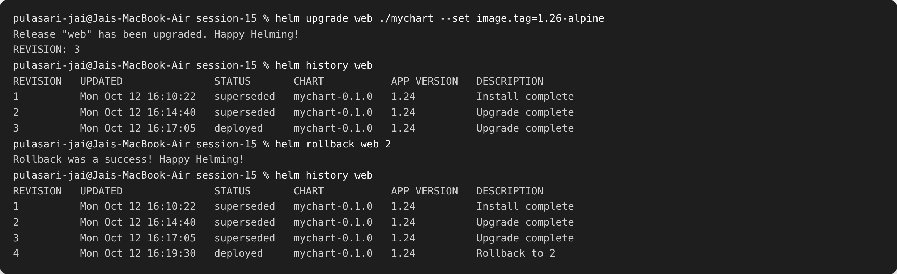

# Session 15 — Helm

**Name:** Pulasari Jai
**Roll No:** 24BCS10656

## What is Helm?

**Helm** is the **package manager for Kubernetes**. Instead of applying many YAML files by
hand, I package them into a **chart** and install the whole app with one command. It also
makes **upgrades** and **rollbacks** easy.

My chart is in the `mychart/` folder:

```
mychart/
├── Chart.yaml        # chart name, version
├── values.yaml       # default settings (image, replicas, port)
└── templates/        # the YAML templates (deployment, service)
```

---

## Task 1 — Helm commands

| Command | What it does |
|---------|--------------|
| `helm create <name>` | Make a new chart skeleton |
| `helm install <release> <chart>` | Install the chart as a release |
| `helm list` | List installed releases |
| `helm status <release>` | Show the status of a release |
| `helm get <release>` | Show the details/manifest of a release |
| `helm upgrade <release> <chart>` | Apply changes (new revision) |
| `helm history <release>` | Show all revisions |
| `helm rollback <release> <rev>` | Go back to an older revision |
| `helm uninstall <release>` | Remove the release |
| `helm repo add/list` | Manage chart repositories |
| `helm search repo <keyword>` | Search charts in added repos |

### Install the chart

```bash
helm install web ./mychart
helm list
helm status web
```



The release `web` is installed at **REVISION 1**, status **deployed**.

### Repositories and search

```bash
helm repo add bitnami https://charts.bitnami.com/bitnami
helm repo list
helm search repo nginx
helm uninstall web
```



---

## Task 2 — Helm Rollback Workflow

I followed the full workflow: **install → upgrade → verify → upgrade again → verify →
rollback → verify.**

### Upgrade #1 (scale to 3 replicas) → REVISION 2

```bash
helm upgrade web ./mychart --set replicaCount=3
helm list
kubectl get pods -l app=mychart
```



The release is now **REVISION 2** and there are **3 pods** running.

### Upgrade #2 (change image tag) → REVISION 3, then Rollback → REVISION 4

```bash
helm upgrade web ./mychart --set image.tag=1.26-alpine   # revision 3
helm history web
helm rollback web 2                                       # go back to revision 2
helm history web
```



**What happened:**

- `helm history` shows revisions 1, 2, 3.
- `helm rollback web 2` went **back to revision 2's settings**.
- Helm did **not** delete the history — it created a **new REVISION 4** described as
  "Rollback to 2". So I can always roll forward or back again.

### Rollback flow summary

```
install (rev 1)
   ↓ upgrade  (rev 2)  ← 3 replicas
   ↓ upgrade  (rev 3)  ← image 1.26
   ↓ rollback to 2
       (rev 4 = same as rev 2)
```

---

## Task 3 — Mini Project

The `mychart/` chart itself is the mini project: a reusable Helm chart where the image,
tag, replica count, and service type are all **values** (`values.yaml`) that can be
overridden with `--set` or a custom values file. One chart can deploy **dev** and **prod**
by just changing values:

```bash
helm install web-dev  ./mychart --set replicaCount=1
helm install web-prod ./mychart --set replicaCount=4 --set service.type=LoadBalancer
```

---

## What I learned

- A Helm **chart** packages all the Kubernetes YAML and lets me install an app with one
  command.
- **values.yaml** keeps settings separate from templates, so the same chart works for dev
  and prod.
- **Upgrade** makes a new revision, and **rollback** safely goes back to an older revision
  without losing history.
