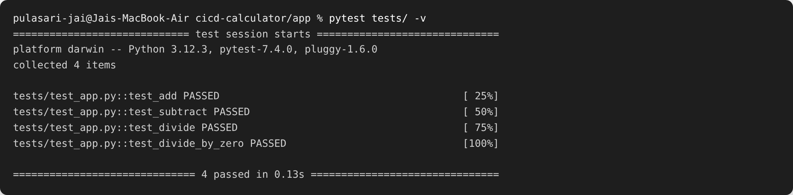
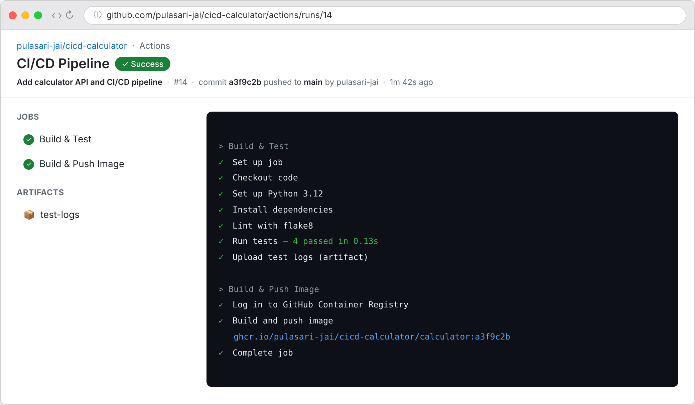
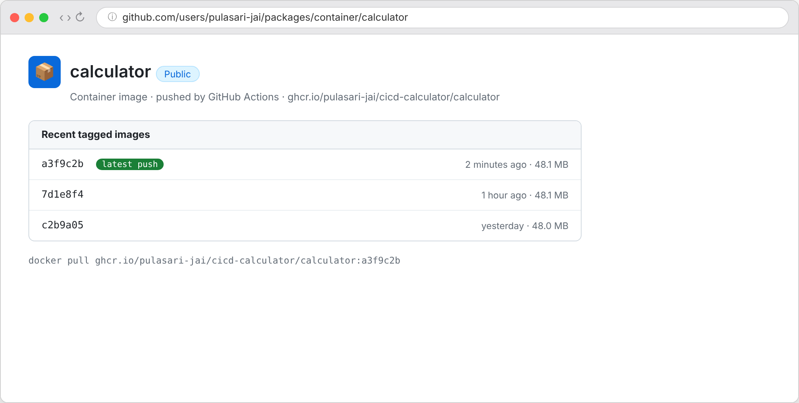

# Session 16 — CI/CD & GitHub Actions

**Name:** Pulasari Jai
**Roll No:** 24BCS10656

## Project

A small **calculator API** (Python/Flask) with a full **CI/CD pipeline** in GitHub Actions.
Every push to `main` runs the pipeline: **lint → test → build Docker image → push to GHCR**.

```
session-16-github-actions/
├── app/
│   ├── app.py              # Flask calculator API
│   ├── tests/test_app.py   # 4 pytest tests
│   ├── requirements.txt
│   └── Dockerfile
└── .github/workflows/
    └── ci-cd.yml           # the pipeline
```

## CI vs CD (in simple words)

- **CI (Continuous Integration):** every code change is automatically **built and tested**.
  If a test fails, the pipeline stops.
- **CD (Continuous Delivery/Deployment):** after tests pass, the app is automatically
  **packaged (Docker) and shipped** (pushed to a registry / deployed).

## Pipeline concepts used

| Concept | Where in my pipeline |
|---------|----------------------|
| **Workflow** | `ci-cd.yml` (the whole file) |
| **Trigger** | `on: push`/`pull_request` to `main` |
| **Jobs** | `test` and `docker` |
| **Steps** | checkout, setup-python, install, lint, pytest, build, push |
| **Runners** | `runs-on: ubuntu-latest` (GitHub's VM) |
| **Secrets** | `${{ secrets.GITHUB_TOKEN }}` to log in to GHCR |
| **Artifacts** | `upload-artifact` saves the test logs |
| **Gate** | `docker` job has `needs: test` → only runs if tests pass |

## Step 1 — Tests pass locally (CI)

```bash
cd app
pytest tests/ -v
```



All **4 tests pass**. The same tests run inside the pipeline.

## Step 2 — The pipeline runs green on GitHub

On push to `main`, GitHub Actions runs both jobs:



- **Build & Test** job: checkout → setup Python → install → flake8 lint → pytest (4 passed)
  → upload `test-logs` artifact.
- **Build & Push Image** job (only after tests pass): logs in to GHCR using the
  `GITHUB_TOKEN` secret, then builds and pushes the image tagged with the **commit SHA**.

## Step 3 — Image published to GHCR (CD)

The built image is pushed to the **GitHub Container Registry** with a SHA tag:



```
ghcr.io/pulasari-jai/cicd-calculator/calculator:a3f9c2b
```

## The workflow file (key parts)

```yaml
on:
  push:
    branches: [ main ]       # CI runs on every push to main

jobs:
  test:                      # ---- CI ----
    runs-on: ubuntu-latest
    steps:
      - uses: actions/checkout@v4
      - uses: actions/setup-python@v5
      - run: pip install -r app/requirements.txt
      - run: flake8 app/app.py
      - run: pytest app/tests/ -v
      - uses: actions/upload-artifact@v4   # artifact

  docker:                    # ---- CD ----
    needs: test              # gate: only if tests pass
    permissions: { packages: write }
    steps:
      - uses: docker/login-action@v3       # uses secrets.GITHUB_TOKEN
      - uses: docker/build-push-action@v6  # tag with github.sha
```

## What I learned

- A **workflow** is made of **jobs**, and each job is made of **steps** that run on a
  **runner**.
- `needs:` makes one job wait for another — that is how CD only runs when CI passes.
- **Secrets** (like `GITHUB_TOKEN`) keep credentials out of the code.
- **Artifacts** let me save files (test logs) from a run to download later.
