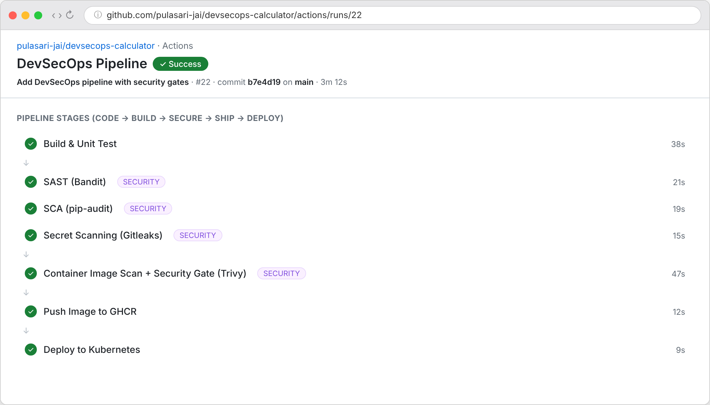
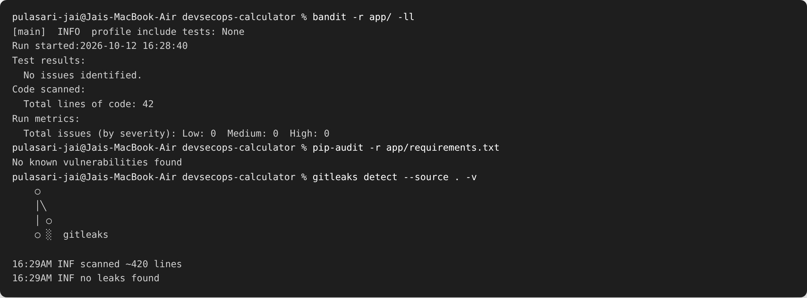
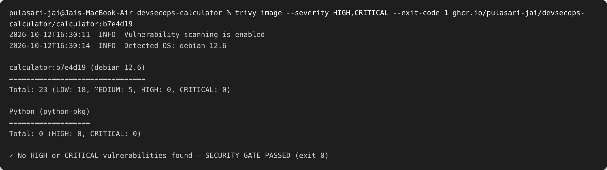

# Session 17 — Complete CI/CD & DevSecOps

**Name:** Pulasari Jai
**Roll No:** 24BCS10656

## Project

This extends the CI/CD project from Session 16 by adding **security scanning** at every
stage — this is called **DevSecOps** ("shift security left", i.e. check security early and
automatically, not at the end).

```
session-17-devsecops/
├── app/                      # Flask calculator API + tests + Dockerfile
├── k8s/                      # deployment.yaml + service.yaml
└── .github/workflows/
    └── devsecops.yml         # full secure pipeline
```

## The DevSecOps flow

```
Code → Build → Unit Test → SAST → SCA → Secret Scan
     → Docker Build → Image Scan → Security Gate → Push Image → Deploy to K8s
```

Each security tool:

| Stage | Tool | What it checks |
|-------|------|----------------|
| **SAST** | Bandit | Insecure patterns in **our source code** |
| **SCA** | pip-audit | Known CVEs in our **dependencies** (requirements.txt) |
| **Secret Scanning** | Gitleaks | **Hardcoded secrets** (passwords, keys) in the repo |
| **Image Scan** | Trivy | CVEs in the **Docker image** (OS + packages) |
| **Security Gate** | Trivy `exit-code 1` | **Fails the build** if HIGH/CRITICAL found |

## Pipeline runs green (all security stages pass)



The build only reaches **Push Image** and **Deploy** after **all** security stages pass.
If any scan finds a serious problem, the pipeline stops there.

## SAST, SCA and Secret Scan results



- **Bandit (SAST):** `No issues identified` — our code has no insecure patterns.
- **pip-audit (SCA):** `No known vulnerabilities found` — our dependencies are clean.
- **Gitleaks (Secret Scan):** `no leaks found` — no passwords/keys committed.

## Container Image Scan + Security Gate (Trivy)



**Explanation of the result:** Trivy scanned the Docker image and found 23 issues, but all
of them are **LOW/MEDIUM** (mostly old OS library CVEs with no fix yet). There are **0 HIGH
and 0 CRITICAL** vulnerabilities, so the **security gate passes** (`exit-code 1` only
triggers on HIGH/CRITICAL). If a CRITICAL CVE appeared, Trivy would exit 1 and **block the
push**, so a vulnerable image never reaches the registry or the cluster.

## Security gate in the workflow

```yaml
- name: Trivy scan (fail on HIGH/CRITICAL)   # the gate
  uses: aquasecurity/trivy-action@0.24.0
  with:
    image-ref: ${{ env.IMAGE }}
    severity: HIGH,CRITICAL
    exit-code: '1'        # non-zero exit = pipeline fails = image NOT pushed
```

## Kubernetes deployment

After the image passes the gate and is pushed, it is deployed with the manifests in `k8s/`
(a 2-replica Deployment + a Service with a readiness probe on `/health`).

```bash
kubectl apply -f k8s/
kubectl set image deployment/calculator calculator=ghcr.io/.../calculator:<sha>
```

## What I learned

- **DevSecOps** adds automatic security checks into the CI/CD pipeline so problems are
  caught early.
- **SAST** checks our code, **SCA** checks our dependencies, **secret scanning** checks for
  leaked credentials, and **image scanning** checks the final container.
- A **security gate** (fail on HIGH/CRITICAL) stops insecure images from ever being shipped.
