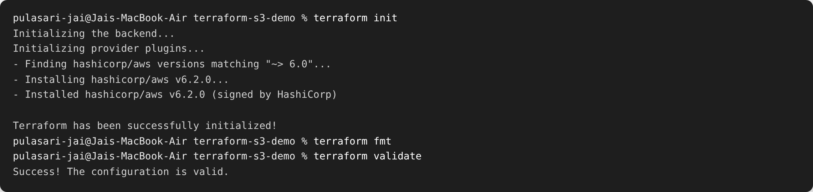
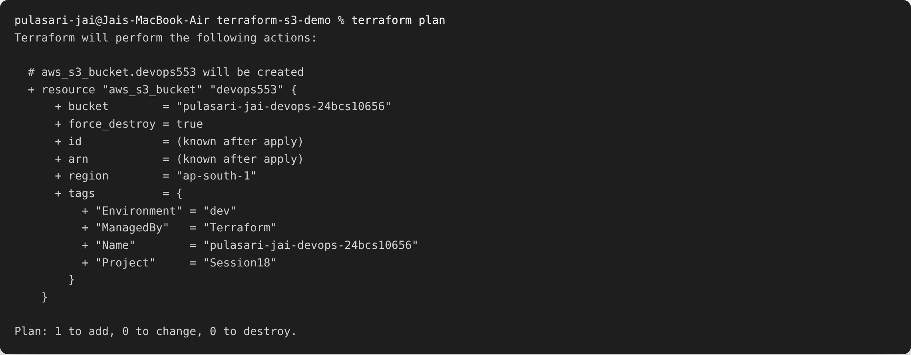
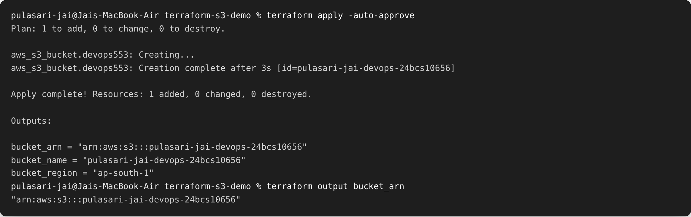
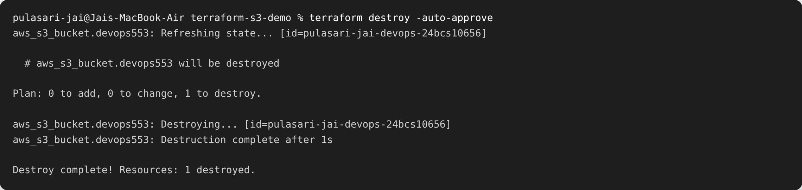

# Session 18 — Terraform & Infrastructure as Code

**Name:** Pulasari Jai
**Roll No:** 24BCS10656

## What is Infrastructure as Code (IaC)?

Instead of creating cloud resources by hand in the AWS console, **IaC** lets me write them
as **code** (Terraform `.tf` files). The benefits: it is **repeatable**, **version
controlled** in Git, and easy to **destroy and recreate**.

## Task 1 — Terraform S3 Demo

Creates an **AWS S3 bucket** with Terraform. Files are in
[`terraform-s3-demo/`](terraform-s3-demo/):

```
terraform-s3-demo/
├── main.tf                 # the S3 bucket resource
├── variables.tf            # region + bucket name variables
├── outputs.tf              # bucket name, ARN, region
├── providers.tf            # AWS provider
├── terraform.tf            # required versions
├── terraform.tfvars.example
└── .gitignore              # keeps state + tfvars out of Git
```

### The Terraform workflow

**1. init / fmt / validate**

```bash
terraform init        # download the AWS provider
terraform fmt         # format the files
terraform validate    # check the config is valid
```



**2. plan** — preview what will be created

```bash
terraform plan
```



The plan says **1 to add** — it will create one S3 bucket.

**3. apply** — create the bucket, and show the outputs

```bash
terraform apply -auto-approve
terraform output bucket_arn
```



**4. destroy** — remove the bucket so there are no AWS charges

```bash
terraform destroy -auto-approve
```



> **Important:** AWS keys are **never** committed. `.gitignore` excludes `*.tfstate` and
> `terraform.tfvars`, and credentials come from `aws configure` / environment variables,
> not from the code.

## Task 2 — AWS Services Research

Separate README for each service in [`aws-services/`](aws-services/):

| Service | Folder |
|---------|--------|
| IAM — Governance | [`aws-services/01-iam/`](aws-services/01-iam/README.md) |
| EC2 — Compute | [`aws-services/02-ec2/`](aws-services/02-ec2/README.md) |
| S3 — Storage | [`aws-services/03-s3/`](aws-services/03-s3/README.md) |
| VPC — Networking | [`aws-services/04-vpc/`](aws-services/04-vpc/README.md) |
| DynamoDB & RDS — Databases | [`aws-services/05-dynamodb-rds/`](aws-services/05-dynamodb-rds/README.md) |

## What I learned

- Terraform follows a clear cycle: **init → plan → apply → destroy**.
- `plan` shows exactly what will change **before** anything happens.
- Keeping **state files and credentials out of Git** is a must.
- Running `destroy` after testing avoids surprise AWS bills.
