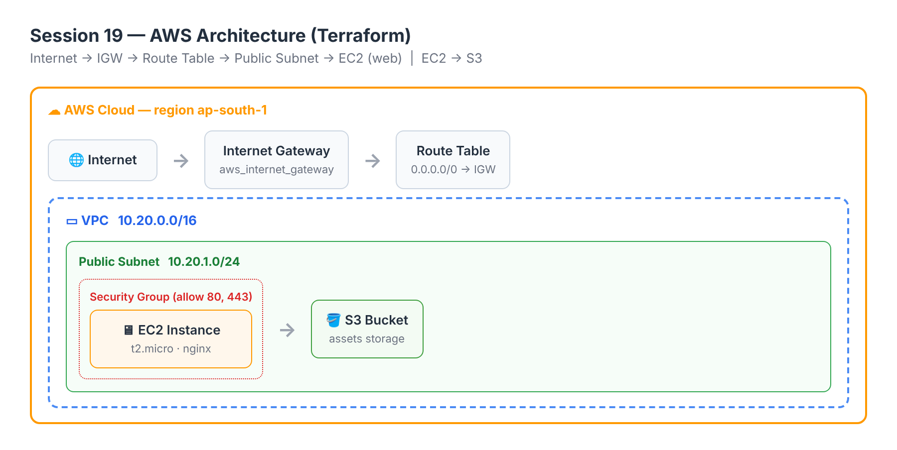
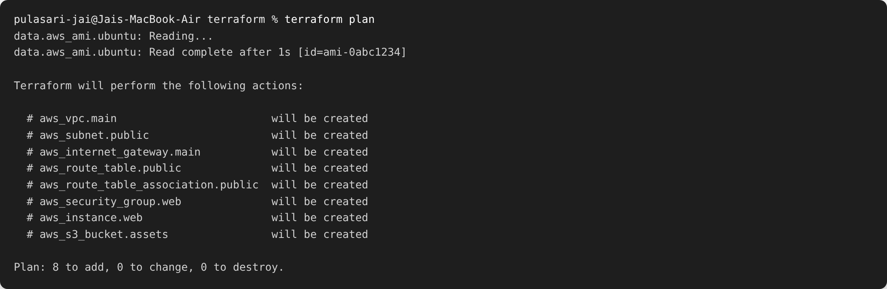
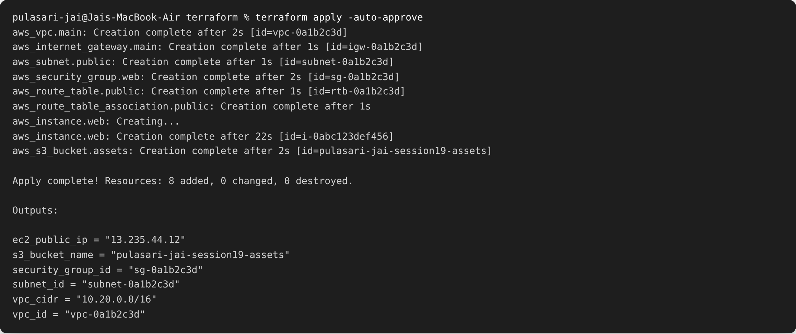
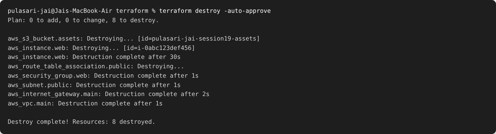

# Session 19 — Cloud & Terraform in Action

**Name:** Pulasari Jai
**Roll No:** 24BCS10656

## Project

An **end-to-end AWS infrastructure** built with Terraform. It creates a full network and a
web server, showing how Terraform handles **providers, variables, resources, outputs,
dependencies, and state**.

## Architecture

```
Internet → Internet Gateway → Route Table → Public Subnet → EC2 (nginx)
                                                              EC2 → S3 bucket
```



Terraform files are in [`terraform/`](terraform/):

| Resource | File | Purpose |
|----------|------|---------|
| VPC `10.20.0.0/16` | main.tf | the private network |
| Public Subnet `10.20.1.0/24` | main.tf | where the EC2 lives |
| Internet Gateway + Route Table | main.tf | gives internet access |
| Security Group (80, 443) | main.tf | firewall for the EC2 |
| EC2 instance (t2.micro, nginx) | main.tf | the web server |
| S3 bucket | main.tf | object storage |

## Terraform concepts shown

- **Provider** → `provider "aws"` in `versions.tf`.
- **Variables** → `aws_region`, `instance_type`, `bucket_name` in `variables.tf`.
- **Resources** → VPC, subnet, IGW, route table, SG, EC2, S3 in `main.tf`.
- **Outputs** → VPC id, subnet id, SG id, EC2 public IP, S3 name in `outputs.tf`.
- **Dependencies** → the EC2 uses `aws_subnet.public.id` and `aws_security_group.web.id`,
  so Terraform **automatically** creates the VPC → subnet → SG **before** the EC2.
- **State** → Terraform tracks what it created in `terraform.tfstate` (kept out of Git).

## Workflow

### 1. plan

```bash
terraform init
terraform plan
```



The plan shows **8 resources to add** (plus it reads the AMI data source).

### 2. apply

```bash
terraform apply -auto-approve
```



Terraform created everything **in the right order** (VPC first, EC2 after the subnet and
SG exist). The **outputs** give the EC2 public IP (`13.235.44.12`) and the S3 bucket name.

### 3. destroy

```bash
terraform destroy -auto-approve
```



All 8 resources were removed cleanly (important to avoid AWS charges). Terraform destroys
in **reverse dependency order** (EC2 before the subnet/VPC).

## Note on secrets

`.gitignore` excludes `*.tfstate` and `*.tfvars`, and AWS credentials come from
`aws configure`/environment variables — **never committed to Git**.

## What I learned

- Terraform figures out the **order** of resource creation automatically from the
  references between them (dependencies).
- **Outputs** are a handy way to get important values (like the EC2 IP) after apply.
- The **state file** is how Terraform knows what already exists, so `plan` can show only
  the differences.
