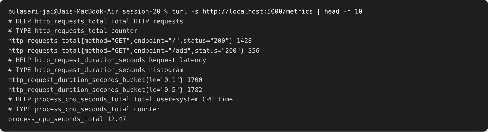
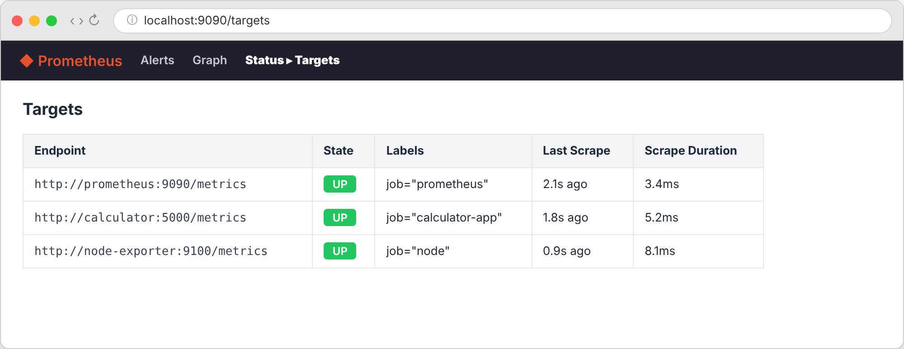
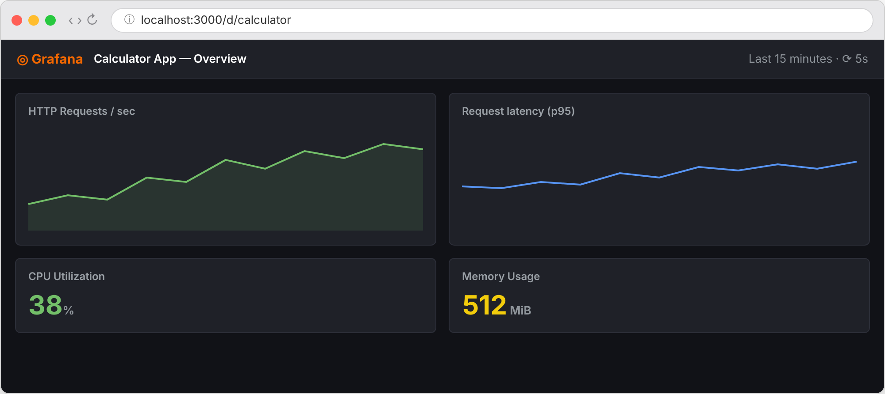
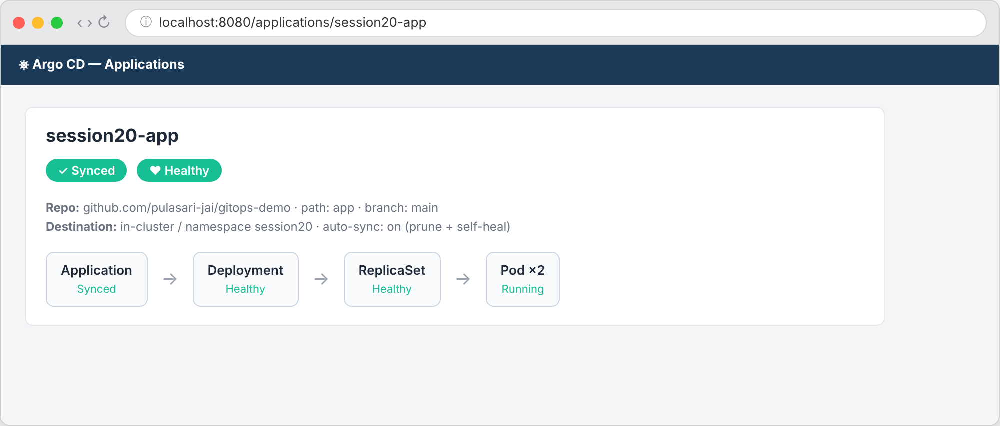

# Session 20 — Monitoring, Observability & GitOps

**Name:** Pulasari Jai
**Roll No:** 24BCS10656

## Task 1 — Monitoring

**Monitoring** means watching a system to know if it is healthy and to get **alerts** when
something goes wrong. I used **Prometheus** (collects metrics) + **Grafana** (shows them on
dashboards). The stack is in [`monitoring/`](monitoring/) (`docker-compose.yml` +
`prometheus.yml`).

```bash
cd monitoring
docker compose up -d        # starts Prometheus (9090) + Grafana (3000)
```

### The app exposes metrics at `/metrics`

```bash
curl http://localhost:5000/metrics
```



This is **Prometheus format** — counters like `http_requests_total` and CPU/latency metrics
that Prometheus scrapes.

### Prometheus is scraping the app (Targets = UP)



All targets are **UP**, which means Prometheus is successfully collecting metrics.

### Grafana dashboard (live metrics)



Panels show **HTTP requests/sec, request latency, CPU utilization (38%), and memory usage
(512 MiB)**. **Alerts** can be set on any panel (e.g. alert if CPU > 80% or error rate
rises).

### What monitoring gives me

| Thing | Example |
|-------|---------|
| **Metrics** | requests/sec, CPU %, memory |
| **Logs** | app log lines (errors, requests) |
| **Alerts** | notify when CPU > 80% or app is down |
| **App health** | is `/health` returning OK? are pods Running? |

---

## Task 2 — Observability (the 3 pillars)

**Observability** is being able to understand **why** a system behaves the way it does,
using its outputs. The **3 pillars**:

| Pillar | What it means | Tools |
|--------|---------------|-------|
| **Metrics** | Numbers over time (CPU, requests/sec, latency) | Prometheus, Grafana |
| **Logs** | Text records of events (errors, requests) | Loki, ELK (Elasticsearch) |
| **Traces** | The full path of one request across services | Jaeger, Tempo, OpenTelemetry |

### Why observability is required

- Monitoring tells you **something is wrong** (CPU high).
- Observability helps you find **why** — e.g. a trace shows the slow service, and logs show
  the exact error. In microservices, one request touches many services, so you need traces
  to follow it.

### Kubernetes observability

- **Metrics:** `metrics-server` + Prometheus scrape pod/node metrics.
- **Logs:** `kubectl logs`, or a stack like Loki/ELK to collect all pod logs.
- **Traces:** OpenTelemetry sidecars/agents send traces to Jaeger/Tempo.

---

## Task 3 — GitOps

### What is GitOps?

**GitOps** means using **Git as the single source of truth** for your infrastructure and
deployments. You describe the desired state in Git (YAML), and a tool automatically makes
the cluster match it. I used **Argo CD**. Config is in [`gitops/`](gitops/).

### Key ideas

- **Git as source of truth:** the cluster's desired state lives in a Git repo, not in
  someone's laptop. To change the app, you change Git.
- **Declarative configuration:** you describe **what** you want (2 replicas, this image),
  not the step-by-step commands.
- **Continuous reconciliation:** Argo CD constantly compares Git vs the cluster. If they
  differ (someone changed something by hand), it **auto-heals** back to what Git says.

### GitOps workflow

```
Developer → edits YAML → git push → Argo CD detects change
         → syncs cluster to match Git → app updated
```

### Argo CD application (Synced + Healthy)

```bash
kubectl apply -f gitops/argocd-application.yaml
```



Argo CD shows the app as **Synced** (cluster matches Git) and **Healthy** (pods running).
With `prune: true` and `selfHeal: true`, any manual change is automatically reverted to the
Git version.

### Kubernetes + GitOps

- Store all K8s manifests (Deployment, Service, etc.) in Git.
- Argo CD watches the repo and applies changes automatically.
- No more manual `kubectl apply` — **Git is the control panel**.

---

## What I learned

- **Monitoring** (Prometheus + Grafana) shows metrics and raises alerts; the app must
  expose a `/metrics` endpoint.
- **Observability** = metrics + logs + traces, which together explain *why* something
  happens, not just *that* it happened.
- **GitOps** (Argo CD) keeps the cluster in sync with Git automatically, so Git is the
  single source of truth.
