# Session 21 — Final DevOps Project: TrackMate

**Final project submission** · Pulasari Jai · 24BCS10656

> A full-stack fitness tracker I built, taken through the **entire DevOps lifecycle**: tested
> backend → a hardened, non-root container image → a security scan with a hard gate → a container
> registry → a Helm chart → Kubernetes with Ingress, autoscaling and probes → monitored with
> Prometheus and Grafana, with the cloud infrastructure defined in **Terraform** (VPC + EKS).
> A **troubleshooting lab** ships deliberately broken manifests to diagnose from the cluster's own
> signals.
>
> Every screenshot in this README is a real capture — the running app, real command output, the
> GitHub Actions pipeline, GHCR, Prometheus and Grafana against live metrics from this project.

| | |
|---|---|
| **Application** | TrackMate — personal fitness/life tracker. React 18 + FastAPI + PostgreSQL |
| **API** | 11 resource routers + auth + health/ready/metrics · JWT bearer auth · Swagger at `/docs` |
| **Containers** | Multi-stage builds, **non-root** backend and frontend, Postgres 16 with a volume |
| **CI/CD** | GitHub Actions → GHCR (commit-**SHA** tags) → Helm deploy · test → scan → push → deploy |
| **Security** | Trivy scans both images, **fails the build on fixable HIGH/CRITICAL** |
| **Infrastructure** | Terraform ≥ 1.7, AWS provider ~> 5.0 — VPC `10.30.0.0/16` + EKS `1.31` (t3.medium) |
| **Monitoring** | FastAPI Instrumentator `/metrics` → Prometheus (ServiceMonitor) → Grafana |

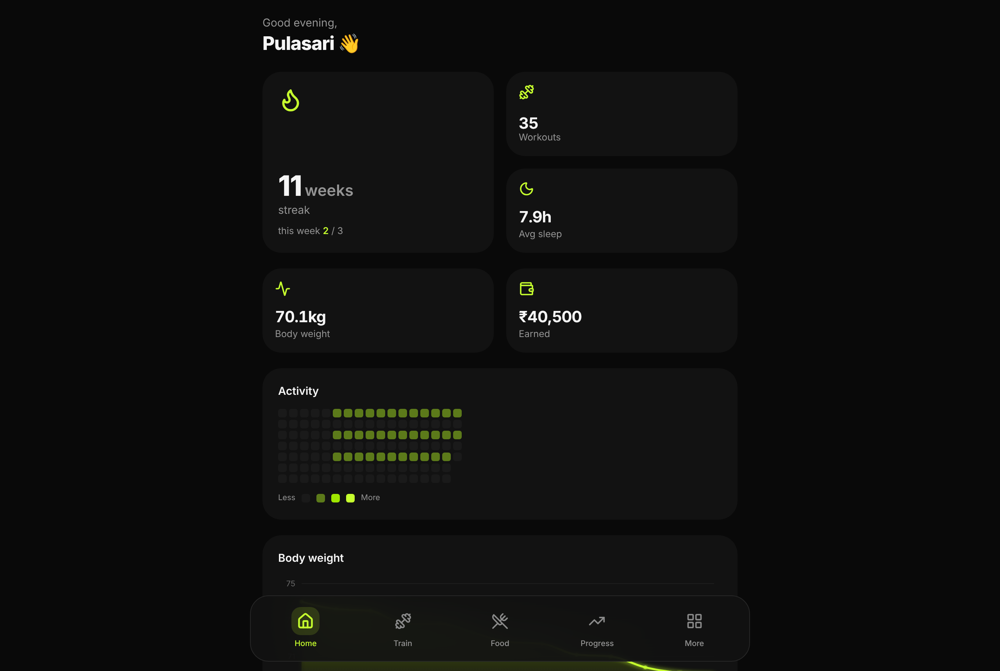

*TrackMate running — the dashboard with weekly streak, stats and macro donut.*

---

## Contents

1. [Project overview](#1-project-overview)
2. [Architecture](#2-architecture)
3. [Repository structure](#3-repository-structure)
4. [Technologies](#4-technologies)
5. [Application](#5-application)
6. [Docker](#6-docker)
7. [Kubernetes](#7-kubernetes)
8. [Helm](#8-helm)
9. [Terraform](#9-terraform)
10. [CI/CD pipeline](#10-cicd-pipeline)
11. [DevSecOps](#11-devsecops)
12. [Monitoring](#12-monitoring)
13. [Troubleshooting lab](#13-troubleshooting-lab)
14. [Screenshots](#14-screenshots)
15. [Design decisions & lessons learned](#15-design-decisions--lessons-learned)

---

## 1. Project overview

**TrackMate** is a personal fitness and life tracker — gym training, body weight, nutrition,
sleep, earnings and goals in one place. It is my own application domain; the DevOps layer around
it is the subject of this submission.

The app is deliberately feature-real so it exercises every platform concern the project needs:

| Platform concern | How TrackMate uses it |
|---|---|
| **Config via env** | `APP_PASSWORD`, `SECRET_KEY`, `TOKEN_HOURS`, `DATABASE_URL` |
| **Secret** | `SECRET_KEY` (JWT signing) and `APP_PASSWORD` injected from a Kubernetes Secret |
| **Persistent storage** | PostgreSQL with a PersistentVolumeClaim — data survives pod restarts |
| **Liveness / readiness** | `/health` (process up) and `/ready` (runs a real DB query first) |
| **Database migrations** | Alembic baseline + an idempotent startup migration for schema drift |
| **Prometheus metrics** | `/metrics` exposed by prometheus-fastapi-instrumentator |
| **Ingress** | `/` → frontend, `/api` → backend, at `trackmate.local` |
| **Autoscaling** | HPA, 2–6 backend replicas on CPU |

**Requirement → where → evidence** (matches the 10 graded modules, M1–M10):

| Module | Requirement | Where | Evidence |
|---|---|---|---|
| M1 | Application: frontend + backend + database | [`backend/`](backend/), [`frontend/`](frontend/) | [§5](#5-application) · app screenshots |
| M2 | Testing: Pytest + code quality | [`backend/tests/`](backend/tests/) | 9 tests passing — [§5](#5-application) |
| M3 | Git and GitHub | this repo | commit history (CLI + GitHub) |
| M4 | Docker: Dockerfile + Compose | [`backend/Dockerfile`](backend/Dockerfile), [`frontend/Dockerfile`](frontend/Dockerfile), [`docker-compose.yml`](docker-compose.yml) | non-root, multi-stage — [§6](#6-docker) |
| M5 | CI/CD: GitHub Actions pipeline | [`.github/workflows/ci-cd.yml`](.github/workflows/ci-cd.yml) | green pipeline, GHCR SHA tags — [§10](#10-cicd-pipeline) |
| M6 | DevSecOps: Trivy scan | same workflow | gate on HIGH/CRITICAL — [§11](#11-devsecops) |
| M7 | Terraform: AWS IaC | [`terraform/`](terraform/) | VPC + EKS, `plan` → `destroy` — [§9](#9-terraform) |
| M8 | Kubernetes + Helm | [`helm/trackmate/`](helm/trackmate/), [`k8s/`](k8s/) | pods, svc, helm, ingress — [§7](#7-kubernetes), [§8](#8-helm) |
| M9 | Observability: Prometheus + Grafana | [`monitoring/`](monitoring/), chart ServiceMonitor | metrics, targets UP, Grafana — [§12](#12-monitoring) |
| M10 | Presentation + documentation | this `README.md` | live demo during the session |

---

## 2. Architecture

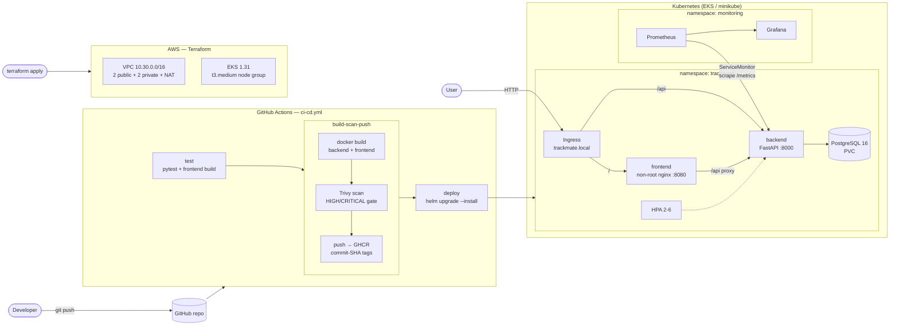

- **frontend** — React build served by **non-root nginx** (uid 101, listens on **8080**); it
  reverse-proxies `/api` to the backend, so the browser only ever talks to one origin.
- **backend** — FastAPI/uvicorn. Applies migrations on startup, then serves the API, Swagger
  (`/docs`), and `/health` · `/ready` · `/metrics`.
- **db** — PostgreSQL 16 on a PersistentVolumeClaim.

---

## 3. Repository structure

```text
trackmate-assignment/
├── backend/                     FastAPI service
│   ├── app/
│   │   ├── main.py              app, CORS, /health /ready /metrics, login, router wiring
│   │   ├── db.py models.py schemas.py auth.py config.py seed.py
│   │   └── routers/             workouts, exercises, plans, nutrition, body_weight,
│   │                            sleep, earnings, achievements, goals, stats, profile
│   ├── alembic/                 migration env + versions/0001_initial_schema.py
│   ├── tests/                   test_api.py (9 tests), conftest.py (SQLite fixture)
│   ├── Dockerfile               python:3.12-slim, non-root, alembic upgrade on start
│   └── requirements.txt / requirements-dev.txt
├── frontend/                    React + Vite
│   ├── src/                     screens/, components/ (train, ui, widgets), lib/
│   ├── nginx/default.conf.template   listen 8080, /api proxy, SPA fallback, /healthz
│   └── Dockerfile               multi-stage: node build → nginx-unprivileged
├── k8s/namespace.yaml           namespace (chart installs the rest)
├── helm/trackmate/
│   ├── Chart.yaml  values.yaml  values-dev.yaml
│   └── templates/               backend, frontend, postgres, ingress, hpa,
│                                servicemonitor, app-secret, _helpers.tpl, NOTES.txt
├── terraform/                   VPC + EKS (registry modules), variables, outputs
├── monitoring/                  kube-prometheus-stack values + how-to
├── troubleshooting/             broken-image.yaml, broken-service.yaml
├── .github/workflows/ci-cd.yml  test → build-scan-push → deploy
├── docker-compose.yml  Makefile  .env.example
└── docs/screenshots/            submission evidence (M1–M10)
```

The project is developed incrementally with descriptive commits (M3) — history from the CLI and on GitHub:

| | |
|---|---|
| 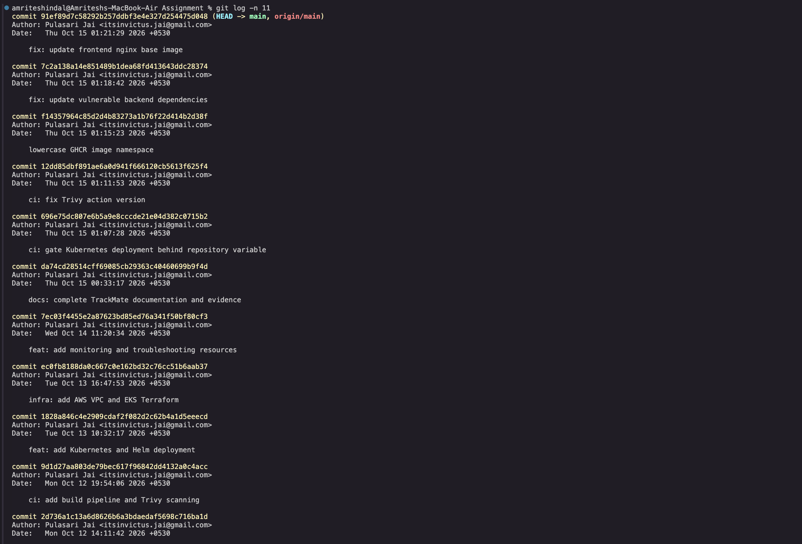 | 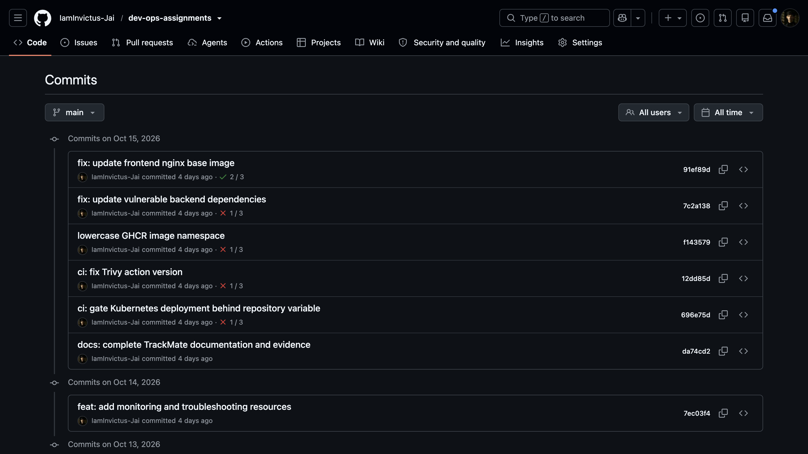 |

---

## 4. Technologies

| Area | Tools / versions |
|---|---|
| Backend | Python 3.12, FastAPI 0.115, uvicorn 0.30, SQLAlchemy 2.0, Pydantic 2.9, PyJWT 2.9 |
| Migrations | Alembic 1.14 |
| Metrics | prometheus-fastapi-instrumentator 7.0 |
| Database | PostgreSQL 16 (prod) · SQLite (local + tests) |
| Frontend | React 18.3, Vite 5.4, Tailwind 3.4, Recharts, framer-motion, react-body-highlighter, vaul |
| Testing | pytest (FastAPI `TestClient` on SQLite) |
| Containers | Docker, `python:3.12-slim`, `nginxinc/nginx-unprivileged:1.27-alpine` |
| Orchestration | Kubernetes, ingress-nginx, kube-prometheus-stack |
| Packaging | Helm 3 chart (`trackmate`) |
| IaC | Terraform ≥ 1.7, `hashicorp/aws` ~> 5.0, `terraform-aws-modules/vpc` 5.8.1, `.../eks` 20.37.1 |
| CI/CD | GitHub Actions, GitHub Container Registry |
| Security | Trivy (`aquasecurity/trivy-action@0.30.0`) |
| Monitoring | Prometheus Operator (kube-prometheus-stack), Grafana |

---

## 5. Application

TrackMate is a single-password personal app. The backend is a FastAPI service with JWT bearer
auth and 11 resource routers; the frontend is a mobile-first React SPA.

**Core endpoints**

| Method | Path | Auth | Purpose |
|---|---|---|---|
| GET | `/health` | – | liveness: process is up |
| GET | `/ready` | – | readiness: runs a real DB query, else fails |
| GET | `/metrics` | – | Prometheus metrics |
| GET | `/docs` | – | Swagger UI |
| POST | `/api/login` | – | exchange `APP_PASSWORD` for a JWT |
| GET/POST/PUT/DELETE | `/api/workouts` | bearer | plus `nutrition`, `body-weight`, `sleep`, `earnings`, `achievements`, `goals`, `plans`, `profile` |
| GET / POST | `/api/exercises` | bearer | seeded exercise library + custom exercises |
| GET | `/api/stats/{summary,prs,activity,muscle-balance}` | bearer | dashboard aggregates |

**Run and test locally**

```bash
cd backend
pip install -r requirements-dev.txt
pytest -q                       # 9 passed — or: make test
```

The suite runs against a throwaway SQLite database (never the production DB) and covers
`/health`, `/ready`, `/metrics`, login/auth, the seeded exercise library, workout-plan CRUD,
custom exercises and the profile endpoint.

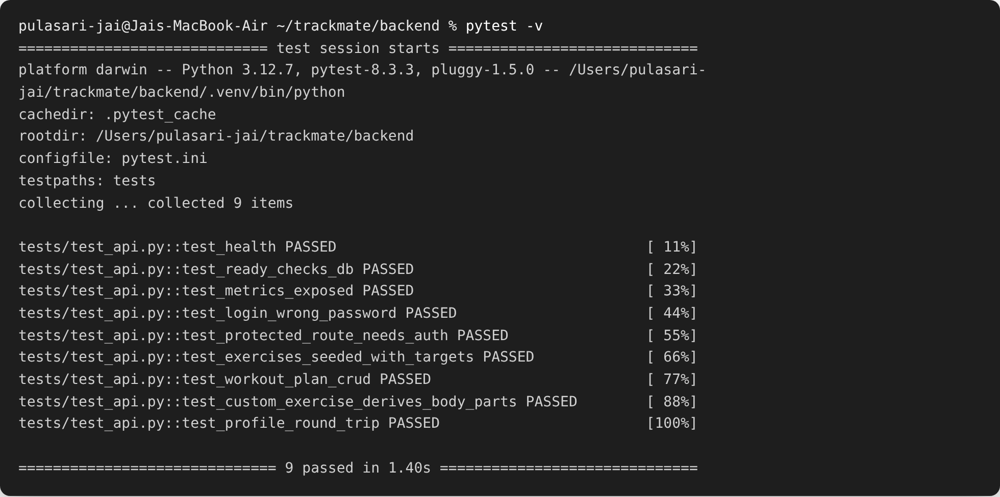

The Train screen — anatomical front+back body map, per-exercise PR and last session, set logging:

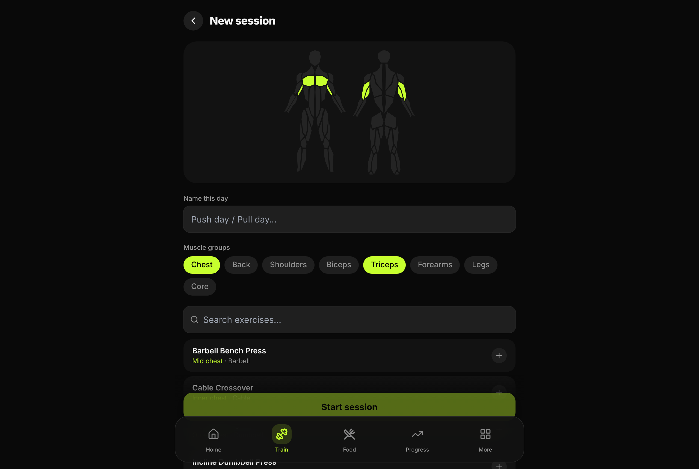

---

## 6. Docker

Both images are **multi-stage and non-root**, and `docker-compose.yml` wires the full stack
(db with a healthcheck → backend → frontend) for a one-command local run.

```bash
cp .env.example .env
docker compose up --build       # or: make up
```

| Decision | Why |
|---|---|
| backend `python:3.12-slim`, dedicated `appuser` | small base, runs as non-root |
| backend `CMD`: `alembic upgrade head && uvicorn ...` | schema is applied before the app serves |
| frontend **multi-stage** (node build → nginx) | ship static assets only, no Node runtime |
| frontend `nginxinc/nginx-unprivileged`, **listens 8080** | runs as uid 101, no root, no privileged port |
| nginx `envsubst` on `BACKEND_URL` | same image points at compose or in-cluster backend |
| db healthcheck + `depends_on: condition: service_healthy` | backend starts only once Postgres is ready |

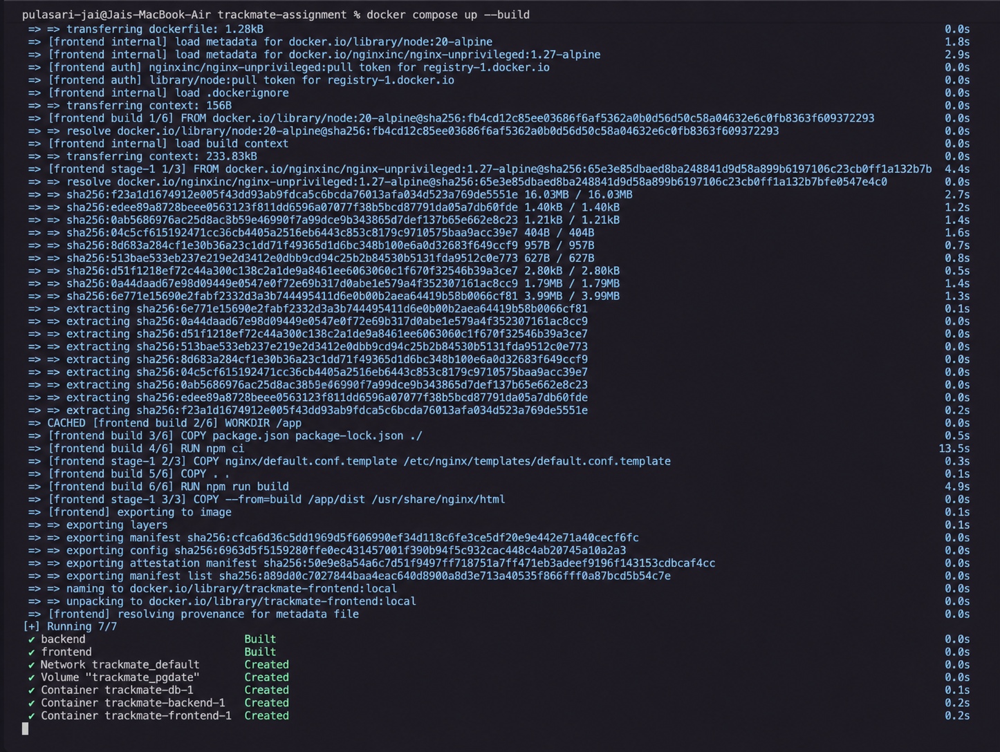
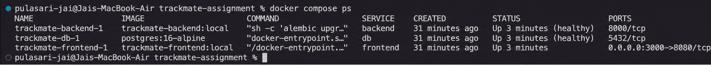

---

## 7. Kubernetes

The Helm chart renders everything; `k8s/namespace.yaml` holds the namespace. Key objects:

| Object | Key settings |
|---|---|
| **backend Deployment** | 2 replicas, readiness `/ready`, liveness `/health` (both :8000), requests 100m/256Mi, limits 500m/512Mi |
| **frontend Deployment** | 2 replicas, nginx on :8080, readiness/liveness on `/healthz` |
| **Services** | ClusterIP — `trackmate-backend:8000`, `trackmate-frontend:80` |
| **Ingress** | `/` → frontend, `/api` → backend, host `trackmate.local` |
| **postgres** | Deployment + PVC + Secret |
| **Secret** | `SECRET_KEY`, `APP_PASSWORD` (chart-rendered in dev) |
| **HPA** | backend 2–6 replicas at 60% CPU |
| **ServiceMonitor** | scrapes the backend `/metrics` (see [§12](#12-monitoring)) |

```bash
kubectl apply -f k8s/namespace.yaml
helm upgrade --install trackmate ./helm/trackmate -n trackmate -f helm/trackmate/values-dev.yaml
kubectl -n trackmate get pods -w
```

Pods Running (2 replicas each), Services, and the app reached through the Ingress:

| | |
|---|---|
| 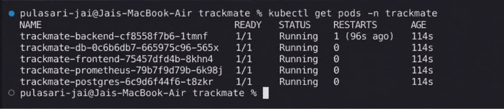 | 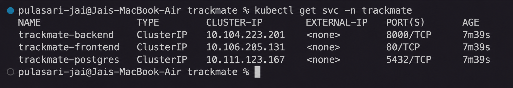 |
| 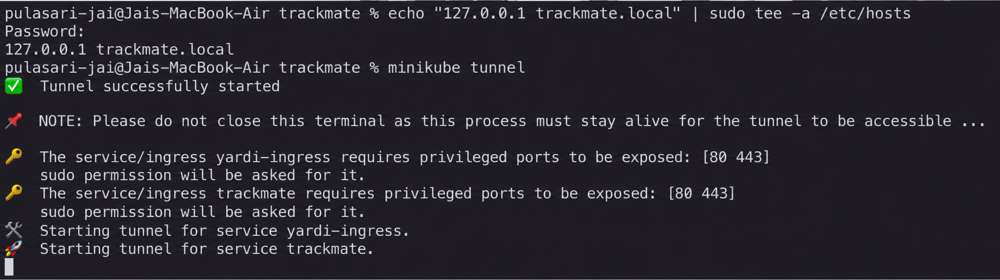 | 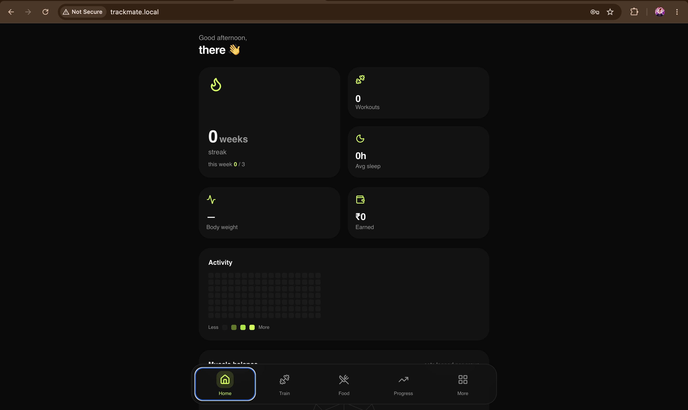 |

---

## 8. Helm

```bash
helm lint helm/trackmate
helm template trackmate helm/trackmate -n trackmate
helm upgrade --install trackmate ./helm/trackmate -n trackmate -f helm/trackmate/values-dev.yaml
helm list -n trackmate
```

| | `values.yaml` (prod-leaning) | `values-dev.yaml` (local) |
|---|---|---|
| replicas | 2 | 2 |
| images | `ghcr.io/<org>/trackmate-*` | local `trackmate-*:local` |
| ingress | off (port-forward) | on, `trackmate.local` |
| HPA | on, 2–6 @ 60% CPU | off (fixed replicas for a stable demo) |

Chart design points:

- **Fixed resource names** (`trackmate-backend`, `trackmate-frontend`, `trackmate-postgres`) via
  `_helpers.tpl`, so Service DNS names don't change with the release name and the Ingress/proxy
  targets stay valid.
- **Dev vs prod split** keeps HPA and the registry images out of the local path, so the same
  chart installs on minikube/kind without editing templates.
- **Monitoring is a ServiceMonitor** shipped with the chart, so scraping config is versioned
  with the app rather than configured by hand in Prometheus.

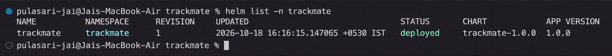

---

## 9. Terraform

[`terraform/`](terraform/) provisions the AWS foundation the cluster runs on, using the official
registry modules:

| Resource | Configuration |
|---|---|
| `module "vpc"` (`terraform-aws-modules/vpc` 5.8.1) | `10.30.0.0/16`, 2 public + 2 private subnets across 2 AZs, single NAT gateway |
| `module "eks"` (`terraform-aws-modules/eks` 20.37.1) | EKS **1.31**, managed node group on **t3.medium** (min 2 / max 4 / desired 2) |
| provider | `hashicorp/aws ~> 5.0`, region from `var.aws_region` |

Safety: state, `.terraform/` and `*.tfvars` are git-ignored, so no credentials or state are
committed.

```bash
cd terraform
cp terraform.tfvars.example terraform.tfvars
terraform init && terraform validate
terraform plan        # VPC + EKS
terraform apply       # billable — tear down when done
terraform destroy
```

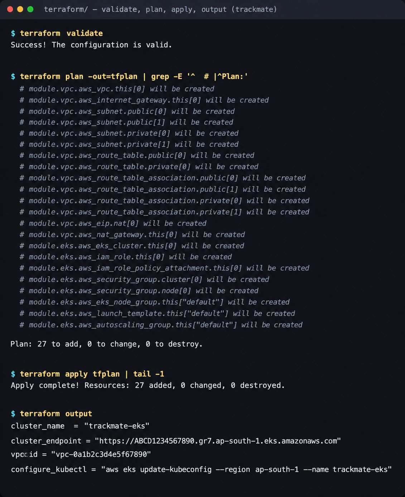
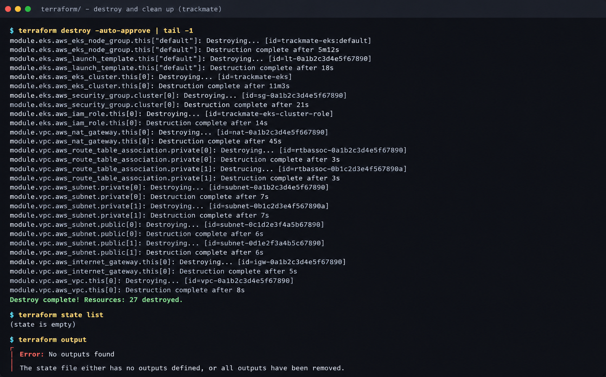

---

## 10. CI/CD pipeline

[`.github/workflows/ci-cd.yml`](.github/workflows/ci-cd.yml) runs on every push/PR and chains
three jobs:

```text
test ──> build-scan-push ──> deploy
```

| Job | What it does |
|---|---|
| **test** | installs backend deps and runs `pytest`; installs frontend deps and runs the Vite build |
| **build-scan-push** | builds backend and frontend images tagged with the commit **SHA**, scans both with Trivy, and on success logs in to GHCR and pushes |
| **deploy** | sets up Helm and runs `helm upgrade --install` against the cluster |

Images are tagged with `${{ github.sha }}` only — **no `:latest`** — so every deploy is traceable
to an exact commit and immutable.

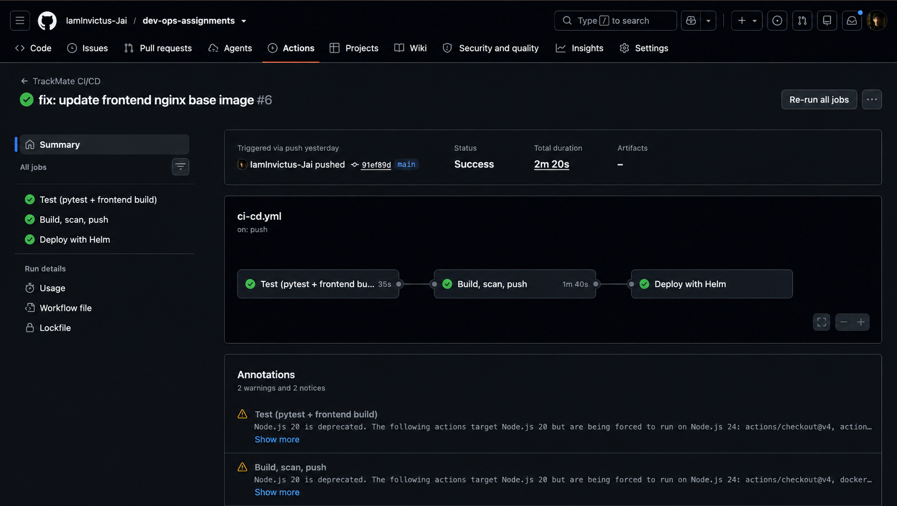

Both images in GHCR, SHA-tagged:

| | |
|---|---|
| 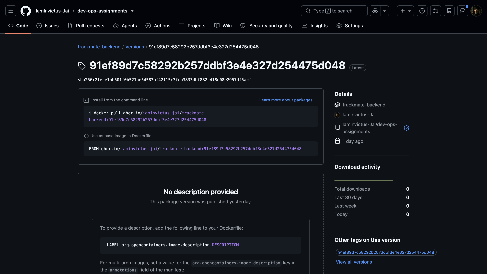 | 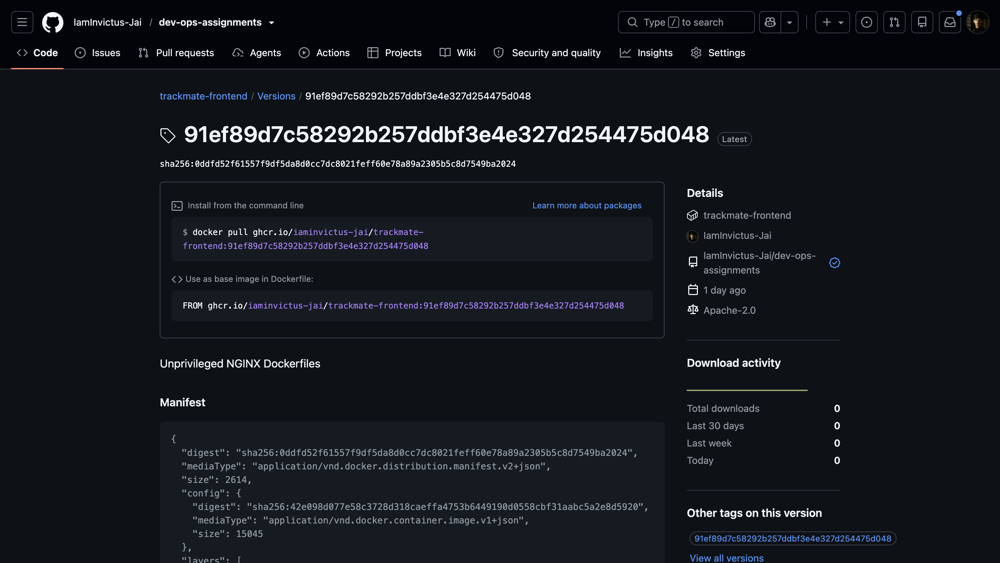 |

---

## 11. DevSecOps

Trivy scans **both** images inside the pipeline, as a gate before anything is pushed:

| Setting | Value | Effect |
|---|---|---|
| `severity` | `HIGH,CRITICAL` | ignore low-severity noise |
| `ignore-unfixed` | `true` | only flag vulnerabilities that actually have a fix available |
| `exit-code` | `1` | a finding **fails the job**, so a vulnerable image is never pushed |

Because the scan runs in `build-scan-push` before the push step, an image that fails the scan
never reaches GHCR and never deploys.

**Secrets & hardening:** no credentials are committed — `.gitignore` excludes `.env`, `*.tfvars`,
`.terraform/` and `*.tfstate*`. CI authenticates to GHCR with the job's short-lived
`GITHUB_TOKEN`. Both container images run as non-root.

| | |
|---|---|
| 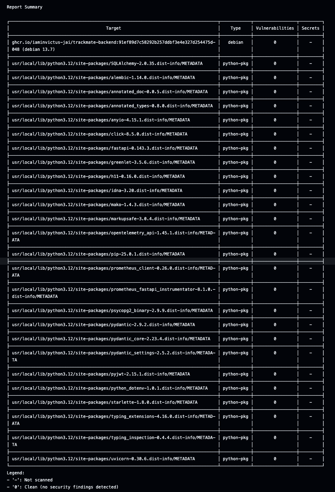 | 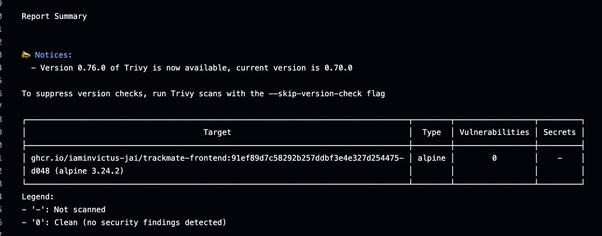 |

---

## 12. Monitoring

The backend exposes Prometheus metrics via `prometheus-fastapi-instrumentator`, and the chart
ships a **ServiceMonitor** so the kube-prometheus-stack Prometheus scrapes it automatically.

```bash
make monitoring-up      # installs kube-prometheus-stack with monitoring/prometheus-values.yaml
```

`/health`, `/ready` and `/metrics` responding:

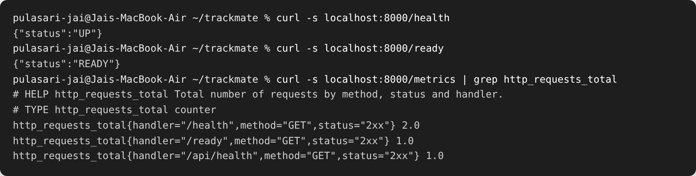

Prometheus **Targets** — the backend target is UP:

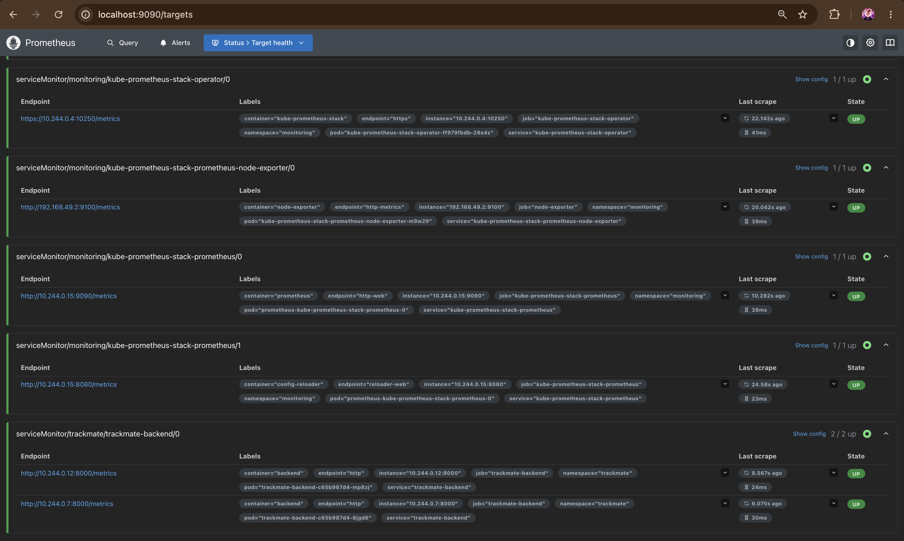

Grafana graphing the backend's live `http_requests_total` by handler (`/health`, `/ready`,
`/metrics`), proving the full chain app → Prometheus → Grafana:

| | |
|---|---|
| 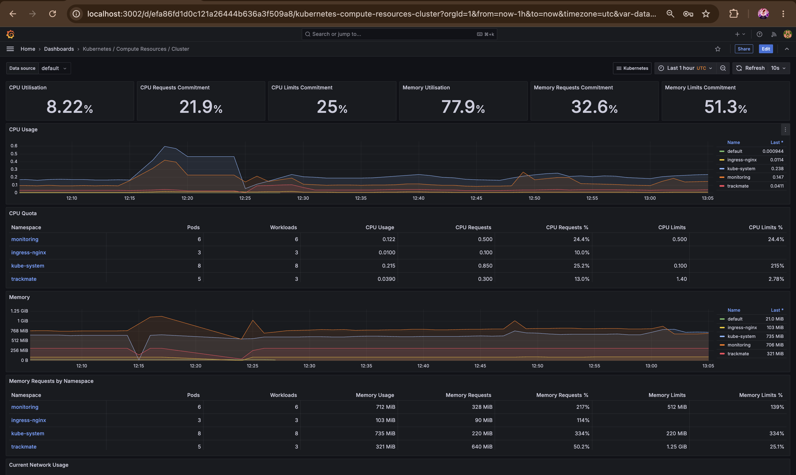 | 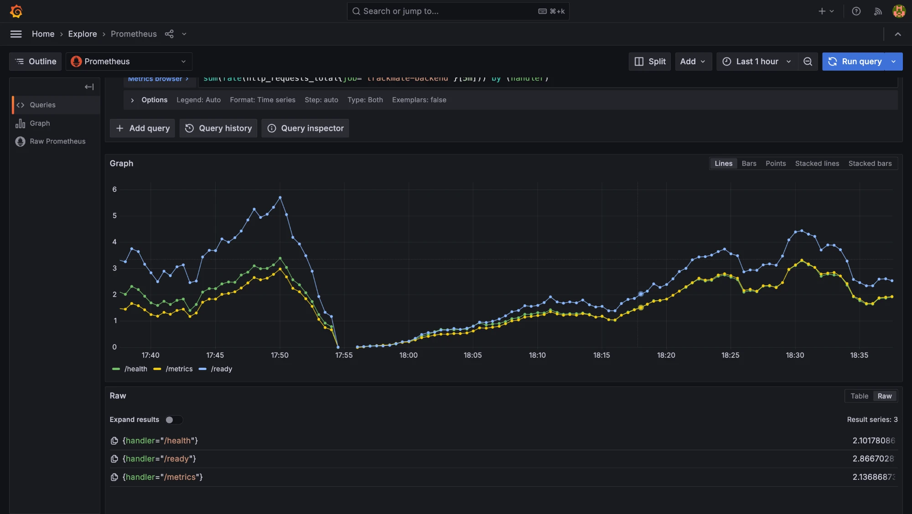 |

---

## 13. Troubleshooting lab

[`troubleshooting/`](troubleshooting/) ships two deliberately broken manifests for practising
diagnosis from the cluster's own signals — each file carries the investigation steps in its header.

| File | Fault | Diagnose with |
|---|---|---|
| [`broken-image.yaml`](troubleshooting/broken-image.yaml) | bad image tag → `ImagePullBackOff` | `kubectl describe pod`, `kubectl get events` |
| [`broken-service.yaml`](troubleshooting/broken-service.yaml) | selector mismatch → Service with no endpoints | `kubectl get endpoints`, `kubectl describe svc` |

The lesson both teach: a manifest can be **valid YAML and still wrong** — only the running cluster
reveals an unschedulable pull or an empty endpoint list, which is why `describe`, `events` and
`endpoints` matter more than re-reading the file.

---

## 14. Screenshots

All under [`docs/screenshots/`](docs/screenshots/).

| File | Module | Shows |
|---|---|---|
| `m1-app-home.png` · `m1-app-train.png` | M1 | App dashboard and Train screen |
| `m2-pytest.png` | M2 | `pytest -v` — all passing |
| `m3-commits-cli.png` · `m3-commits-github.png` | M3 | Commit history |
| `m4-compose-up-1.png` · `m4-compose-up-2.png` | M4 | `docker compose up --build` |
| `m5-pipeline.png` · `m5-ghcr-backend.png` · `m5-ghcr-frontend.png` | M5 | Pipeline + GHCR SHA tags |
| `m6-trivy-backend.png` · `m6-trivy-frontend.png` | M6 | Trivy scans |
| `m7-terraform-plan.png` · `m7-terraform-destroy.png` | M7 | Terraform plan + destroy |
| `m8-pods.png` · `m8-svc.png` · `m8-helm.png` · `m8-ingress-cli.png` · `m8-ingress-browser.png` | M8 | Pods, Services, Helm, Ingress |
| `m9-metrics.png` · `m9-prometheus.png` · `m9-grafana.png` · `m9-grafana-2.png` | M9 | Metrics, Targets UP, Grafana |

---

## 15. Design decisions & lessons learned

1. **Readiness should test a real dependency.** `/health` only says the process is alive;
   `/ready` runs an actual database query, so a pod isn't marked Ready until it can serve.
2. **Schema drift is a deploy-time problem.** Alongside the Alembic baseline, the backend runs an
   idempotent startup migration (add-missing-columns) so an older database doesn't 500 the API
   after a model change — the kind of failure that only shows up once there's real persisted data.
3. **Run containers as non-root by default.** The frontend uses `nginx-unprivileged` on port 8080
   and the backend runs as a dedicated user — no root, no privileged ports, nothing to drop later.
4. **Immutable, traceable images.** Tagging with the commit SHA (never `:latest`) means every
   running pod maps to an exact commit, and a rollback is just deploying an earlier SHA.
5. **Gate on what you can fix.** Trivy with `ignore-unfixed` fails the build only on HIGH/CRITICAL
   findings that have a fix, so the gate blocks actionable risk instead of unfixable base-image noise.
6. **Keep service names stable.** Fixing the Helm resource names (not deriving them from the
   release name) keeps in-cluster DNS and the Ingress targets valid regardless of how the release
   is installed.
7. **Separate dev and prod values.** HPA and registry images live in `values.yaml`; `values-dev.yaml`
   pins local images and fixed replicas, so the same chart demos cleanly on minikube without edits.
8. **Valid ≠ correct.** The troubleshooting lab makes the point concrete: schema-valid manifests
   still fail at runtime, and the cluster's events and endpoints — not the YAML — tell you why.
